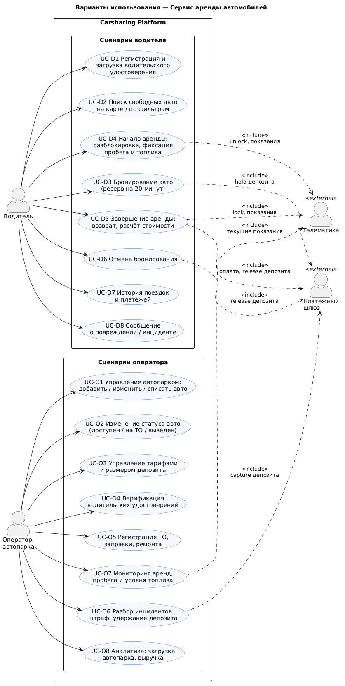
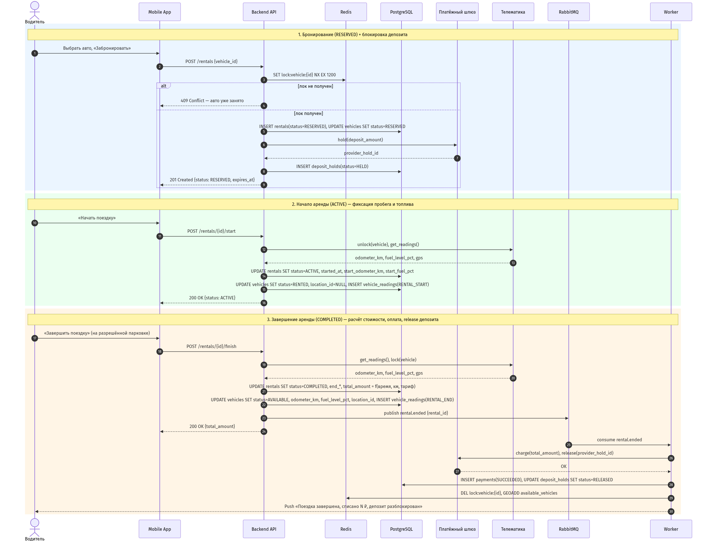
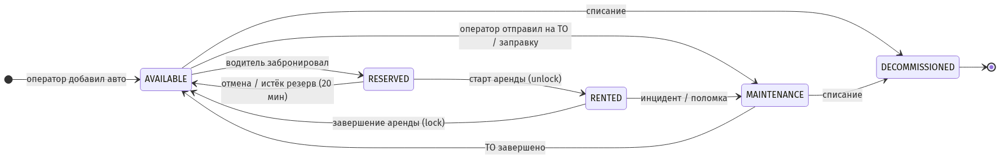
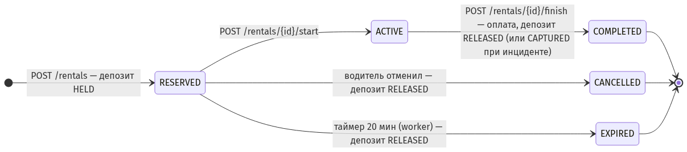
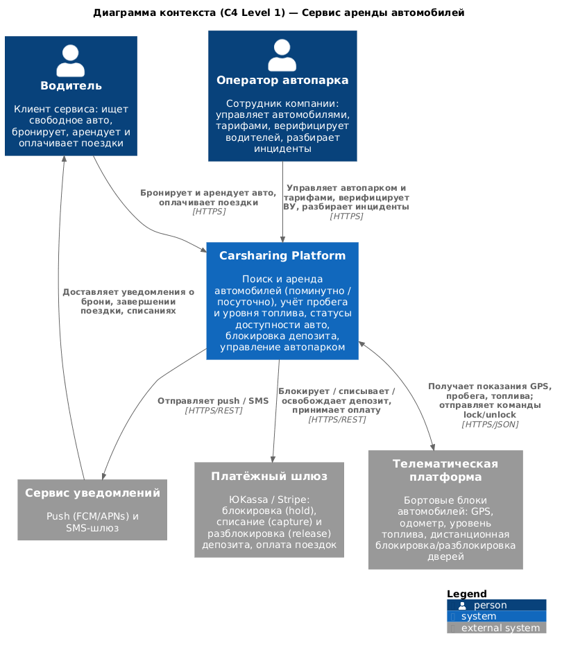
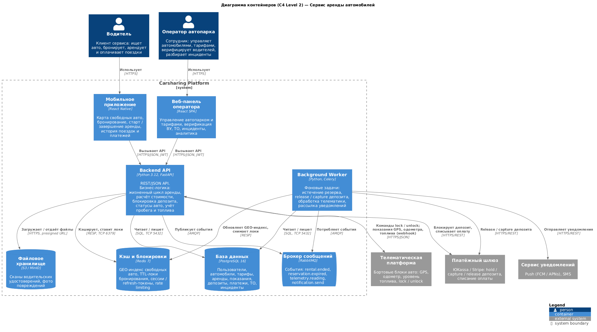
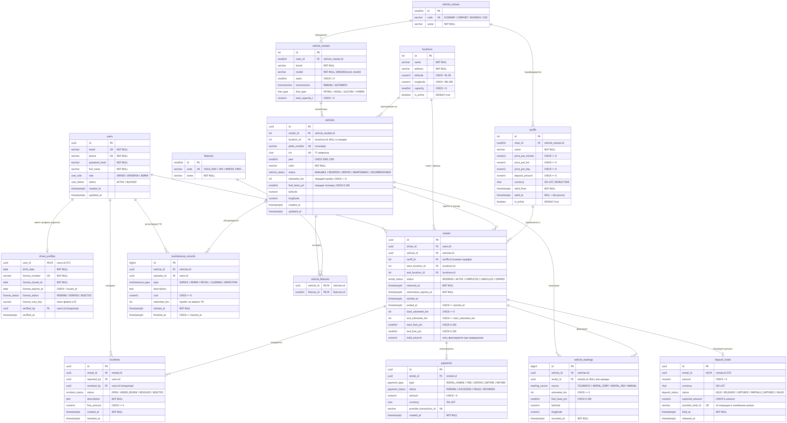
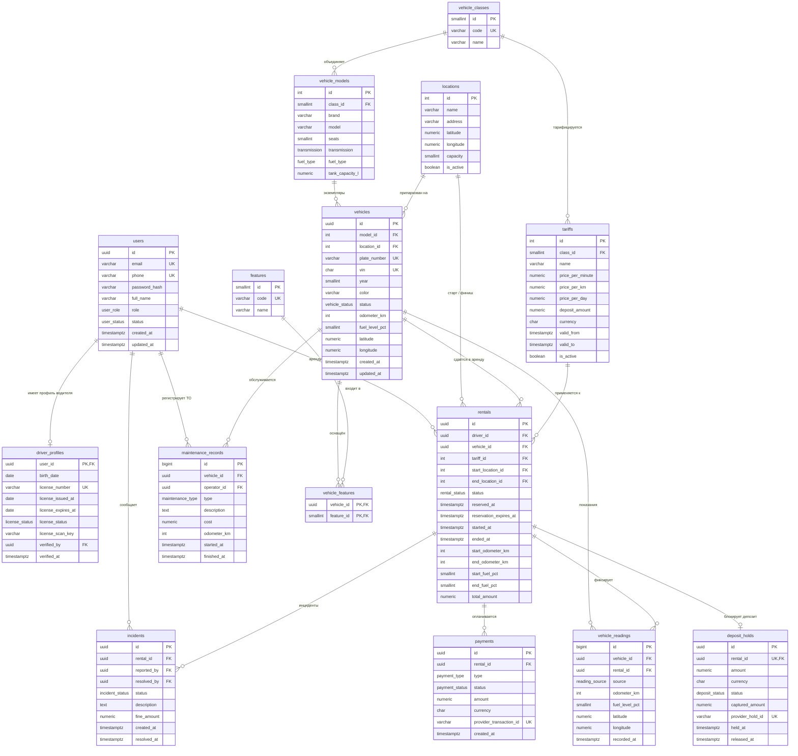

# Архитектура: Сервис аренды автомобилей (Carsharing / Rental API)

> Лабораторная работа №1 по дисциплине «Разработка серверных приложений».
> Тема: проектирование архитектуры серверного приложения и предметной области.
> Вариант 5 — Сервис аренды автомобилей (Carsharing / Rental API).

**Содержание**

1. [Название и описание проекта](#1-название-и-описание-проекта)
2. [Ролевая модель](#2-ролевая-модель)
3. [Сценарии использования (Use Cases)](#3-сценарии-использования-use-cases)
4. [Архитектура приложения (C4 Model)](#4-архитектура-приложения-c4-model)
5. [Модель данных (ERD, 3NF)](#5-модель-данных-erd-3nf)
6. [Ответы на контрольные вопросы](#6-ответы-на-контрольные-вопросы)
7. [Исходные файлы диаграмм](#7-исходные-файлы-диаграмм)

---

## 1. Название и описание проекта

**Carsharing / Rental API** — серверное приложение для сервиса краткосрочной аренды автомобилей.

Водитель через мобильное приложение находит свободный автомобиль на карте, бронирует его, начинает и завершает поездку; система фиксирует пробег и уровень топлива в начале и в конце аренды, рассчитывает стоимость по тарифу и списывает оплату. На время аренды на карте водителя блокируется депозит, который автоматически разблокируется после успешного завершения поездки или частично удерживается при повреждении автомобиля. Оператор автопарка управляет автомобилями, тарифами, верифицирует водительские удостоверения, регистрирует техническое обслуживание и разбирает инциденты.

**Особенности варианта и их реализация**

| Особенность варианта | Как реализована |
|---|---|
| Учёт пробега и уровня топлива | Текущие показания хранятся в `vehicles.odometer_km` / `vehicles.fuel_level_pct`; в `rentals` фиксируются показания на старте и финише (`start_/end_odometer_km`, `start_/end_fuel_pct`); полная история — в журнале `vehicle_readings` (телематика, старт/финиш аренды, ручной ввод). |
| Статус доступности авто | Поле `vehicles.status` с конечным автоматом `AVAILABLE → RESERVED → RENTED → AVAILABLE`, а также `MAINTENANCE` и `DECOMMISSIONED`; гонки при бронировании исключаются TTL-локом в Redis и частичным уникальным индексом «одна незавершённая аренда на автомобиль». |
| Блокировка депозита | Отдельная сущность `deposit_holds` (1:1 к аренде) со статусами `HELD → RELEASED / CAPTURED / PARTIALLY_CAPTURED`; hold выполняется через платёжный шлюз при бронировании, release/capture — фоновым воркером после завершения аренды или разбора инцидента. |

**Границы системы (что не входит в MVP):** страхование, программы лояльности, промокоды, чат с поддержкой, мультивалютность (валюта хранится, но конвертации нет).

---

## 2. Ролевая модель

| Роль | Кто это | Доступ |
|---|---|---|
| **Водитель** (`DRIVER`) | Клиент сервиса, зарегистрированный пользователь с подтверждённым водительским удостоверением | Только свои данные: профиль, бронирования, аренды, платежи, инциденты по своим поездкам. Поиск свободных автомобилей. |
| **Оператор автопарка** (`OPERATOR`) | Сотрудник компании, отвечающий за автопарк | Управление автомобилями, тарифами, парковками; верификация ВУ; все аренды, показания, платежи; регистрация ТО; разбор инцидентов; аналитика. |
| Администратор (`ADMIN`) | Технический администратор системы (не является обязательной ролью для лабораторной, заложена в перечисление) | Всё, что оператор, плюс управление учётными записями операторов. |
| Внешние системы | Платёжный шлюз, телематическая платформа, сервис уведомлений | Взаимодействуют с системой через API / webhook, ролей в системе не имеют. |

Аутентификация — JWT (access + refresh), авторизация — по роли пользователя на уровне обработчиков API.

---

## 3. Сценарии использования (Use Cases)

### 3.1 Водитель

| ID | Сценарий | Описание | Предусловие | Результат |
|---|---|---|---|---|
| UC-D1 | Регистрация и загрузка ВУ | Водитель создаёт аккаунт (email, телефон, пароль), заполняет данные ВУ и загружает его скан | — | Создан `users` + `driver_profiles` со статусом `PENDING` |
| UC-D2 | Поиск свободных авто | Просмотр автомобилей со статусом `AVAILABLE` на карте / по фильтрам (класс, парковка, уровень топлива, опции) | ВУ верифицировано | Список автомобилей с тарифом и расстоянием |
| UC-D3 | Бронирование авто | Резерв автомобиля на 20 минут с блокировкой депозита на карте | Нет другой незавершённой аренды; есть привязанная карта | `rentals.status = RESERVED`, `vehicles.status = RESERVED`, `deposit_holds.status = HELD` |
| UC-D4 | Начало аренды | Водитель подходит к авто, нажимает «Начать поездку»: система разблокирует двери и фиксирует стартовые показания пробега и топлива | Активный резерв не истёк | `rentals.status = ACTIVE`, `vehicles.status = RENTED`, запись в `vehicle_readings` |
| UC-D5 | Завершение аренды | Водитель ставит авто на разрешённую парковку и завершает поездку; система снимает конечные показания, рассчитывает стоимость, списывает оплату и освобождает депозит | Аренда `ACTIVE`, авто в зоне парковки | `rentals.status = COMPLETED`, `vehicles.status = AVAILABLE`, `payments`, `deposit_holds.status = RELEASED` |
| UC-D6 | Отмена бронирования | Отмена резерва до начала поездки | Аренда `RESERVED` | `rentals.status = CANCELLED`, депозит `RELEASED`, авто `AVAILABLE` |
| UC-D7 | История поездок и платежей | Просмотр своих завершённых аренд с пробегом, длительностью, суммой; список платежей и статус депозитов | Авторизован | Список аренд и платежей |
| UC-D8 | Сообщение об инциденте | Водитель сообщает о повреждении / поломке, обнаруженной до или во время поездки | Аренда `RESERVED` или `ACTIVE` | Создан `incidents.status = OPEN` |

### 3.2 Оператор автопарка

| ID | Сценарий | Описание | Результат |
|---|---|---|---|
| UC-O1 | Управление автопарком | Добавление автомобиля (модель, госномер, VIN, год, опции), редактирование, списание | Записи в `vehicles`, `vehicle_features` |
| UC-O2 | Изменение статуса авто | Перевод авто в `MAINTENANCE` / обратно в `AVAILABLE` / `DECOMMISSIONED` | `vehicles.status` |
| UC-O3 | Управление тарифами | Создание тарифа для класса авто: цена за минуту, км, сутки, размер депозита, период действия | Записи в `tariffs` |
| UC-O4 | Верификация ВУ | Проверка скана и данных удостоверения, подтверждение или отклонение | `driver_profiles.license_status = VERIFIED / REJECTED`, `verified_by`, `verified_at` |
| UC-O5 | Регистрация ТО | Фиксация ТО, ремонта, заправки, мойки с пробегом и стоимостью | `maintenance_records`, статус авто `MAINTENANCE` на время работ |
| UC-O6 | Разбор инцидентов | Рассмотрение обращения, назначение штрафа, частичное / полное удержание депозита | `incidents.status = RESOLVED`, `fine_amount`, `deposit_holds.status = CAPTURED`, `payments.type = DEPOSIT_CAPTURE` |
| UC-O7 | Мониторинг аренд, пробега и топлива | Список активных аренд, текущие показания и GPS-координаты авто, авто с низким уровнем топлива | Чтение `rentals`, `vehicles`, `vehicle_readings` |
| UC-O8 | Аналитика | Загрузка автопарка (доля времени в `RENTED`), выручка по классам и периодам, средний пробег поездки | Агрегаты по `rentals`, `payments` |

### 3.3 Диаграмма вариантов использования



Исходник: [docs/diagrams/use-cases.puml](docs/diagrams/use-cases.puml)

### 3.4 Ключевой сценарий: жизненный цикл аренды с депозитом

Сценарий объединяет UC-D3 → UC-D4 → UC-D5 и показывает, как взаимодействуют контейнеры системы при бронировании, старте и завершении аренды.



Исходник: [docs/diagrams/rental-flow.mmd](docs/diagrams/rental-flow.mmd)

Ключевые решения сценария:

- **Защита от двойного бронирования.** Перед созданием аренды API атомарно ставит лок `SET lock:vehicle:{id} NX EX 1200` в Redis; на уровне БД это дублируется частичным уникальным индексом `ux_rentals_vehicle_open` (не более одной аренды в статусах `RESERVED`/`ACTIVE` на автомобиль), поэтому даже при сбое Redis двойная аренда невозможна.
- **Депозит блокируется до выдачи авто.** Если платёжный шлюз отклонил hold, резерв не создаётся.
- **Показания фиксируются дважды** — при старте (`RENTAL_START`) и финише (`RENTAL_END`) — и попадают как в `rentals` (для расчёта), так и в журнал `vehicle_readings` (для истории и аналитики).
- **Оплата и release депозита выполняются асинхронно** воркером по событию `rental.ended`: водитель получает ответ API сразу, а сетевые вызовы к платёжному шлюзу с повторными попытками выполняются в фоне.
- **Истечение резерва** обрабатывается воркером по индексу `ix_rentals_status_expires`: аренды `RESERVED` с `reservation_expires_at < now()` переводятся в `EXPIRED`, депозит освобождается, авто возвращается в `AVAILABLE`.

### 3.5 Диаграммы состояний

**Статус автомобиля (`vehicles.status`)**



**Статус аренды (`rentals.status`) и депозита (`deposit_holds.status`)**



Исходники: [vehicle-states.mmd](docs/diagrams/vehicle-states.mmd), [rental-states.mmd](docs/diagrams/rental-states.mmd)

---

## 4. Архитектура приложения (C4 Model)

### 4.1 Level 1 — System Context



Исходник: [docs/diagrams/c4-context.puml](docs/diagrams/c4-context.puml)

| Внешняя система | Назначение | Направление взаимодействия |
|---|---|---|
| Платёжный шлюз (ЮKassa / Stripe) | Двухстадийные платежи: `hold` депозита при бронировании, `release` после поездки, `capture` при удержании штрафа; списание оплаты поездки | Система → шлюз (REST), шлюз → система (webhook о статусе операции) |
| Телематическая платформа | Бортовые блоки автомобилей: GPS-координаты, показания одометра и уровня топлива, команды блокировки / разблокировки дверей | Система → телематика (команды), телематика → система (webhook с показаниями) |
| Сервис уведомлений (FCM / APNs / SMS) | Push и SMS водителю: подтверждение брони, истечение резерва, итог поездки, списания | Система → сервис |

### 4.2 Level 2 — Container



Исходник: [docs/diagrams/c4-container.puml](docs/diagrams/c4-container.puml)

| Контейнер | Технология | Ответственность |
|---|---|---|
| **Мобильное приложение** | React Native | Интерфейс водителя: карта свободных авто, бронирование, старт / завершение поездки, история, платежи |
| **Веб-панель оператора** | React SPA | Интерфейс оператора: автопарк, тарифы, верификация ВУ, ТО, инциденты, аналитика |
| **Backend API** | Python 3.12, FastAPI, SQLAlchemy | Единая точка входа (REST/JSON, OpenAPI). Аутентификация (JWT) и авторизация по ролям. Доменная логика: жизненный цикл аренды, расчёт стоимости, блокировка депозита, статусы авто, приём телематики. Слои: `api` (роутеры, схемы) → `services` (бизнес-логика) → `repositories` (доступ к данным) |
| **Background Worker** | Python, Celery | Потребляет события из брокера: истечение резервов, `charge` + `release`/`capture` депозита с ретраями, обработка пакетов телематики, отправка уведомлений, обновление GEO-индекса |
| **База данных** | PostgreSQL 16 | Единственный источник истины: пользователи, автопарк, тарифы, аренды, показания, депозиты, платежи, ТО, инциденты. Схема — [db/schema.sql](db/schema.sql) |
| **Кэш и блокировки** | Redis 7 | GEO-индекс свободных авто (`GEOSEARCH` для поиска «рядом со мной»), TTL-локи бронирования (`SET NX EX`), refresh-токены, rate limiting |
| **Брокер сообщений** | RabbitMQ | Асинхронная доставка событий `rental.ended`, `reservation.expired`, `telemetry.reading`, `notification.send` от API к воркеру; гарантия доставки при сбоях |
| **Файловое хранилище** | S3 / MinIO | Сканы водительских удостоверений, фото повреждений; выдача по presigned URL |

**Почему такое разделение**

- API и воркер разделены, чтобы медленные и ненадёжные операции (платёжный шлюз, уведомления) не блокировали HTTP-запросы и могли повторяться при ошибках.
- Redis используется только как ускоритель и для кратковременных локов — вся долговременная информация лежит в PostgreSQL, поэтому потеря кэша не приводит к потере данных.
- Брокер сообщений даёт at-least-once доставку событий: если воркер упал в момент release депозита, событие будет обработано повторно (обработчики идемпотентны за счёт `provider_hold_id` / `provider_transaction_id` с `UNIQUE`).
- Клиенты — тонкие: вся бизнес-логика на сервере, что позволяет позже добавить, например, Telegram-бота без дублирования правил.

### 4.3 Уровень 3 (Component) — структура Backend API

Для ориентира в будущих лабораторных: модули Backend API соответствуют агрегатам предметной области.

```
app/
├── api/            # роутеры FastAPI: /auth, /vehicles, /rentals, /tariffs, /incidents, /telemetry, /admin
├── services/       # бизнес-логика: RentalService, DepositService, PricingService, VehicleService
├── repositories/   # доступ к данным (SQLAlchemy), по одному на агрегат
├── models/         # ORM-модели таблиц
├── schemas/        # Pydantic-схемы запросов / ответов
├── integrations/   # клиенты: PaymentGateway, TelematicsClient, NotificationClient, S3Client
└── workers/        # Celery-задачи: expire_reservations, settle_rental, process_telemetry
```

---

## 5. Модель данных (ERD, 3NF)

### 5.1 Список сущностей

| № | Сущность (таблица) | Назначение | Ключевые атрибуты |
|---|---|---|---|
| 1 | `users` | Учётные записи всех пользователей | email, phone, role, status |
| 2 | `driver_profiles` | Данные водительского удостоверения (1:1 к `users`) | license_number, license_expires_at, license_status |
| 3 | `vehicle_classes` | Классы автомобилей — основа тарификации | code, name |
| 4 | `vehicle_models` | Справочник марок / моделей | brand, model, seats, fuel_type |
| 5 | `locations` | Парковки / зоны выдачи и возврата | address, latitude, longitude, capacity |
| 6 | `vehicles` | Конкретные автомобили автопарка | plate_number, vin, **status**, **odometer_km**, **fuel_level_pct** |
| 7 | `features` | Справочник опций оснащения | code, name |
| 8 | `vehicle_features` | Связь N:M автомобиль ↔ опция | (vehicle_id, feature_id) |
| 9 | `tariffs` | Тарифы по классу авто с периодом действия | price_per_minute, price_per_km, price_per_day, **deposit_amount** |
| 10 | `rentals` | Аренды: резерв → поездка → завершение | status, start_/end_odometer_km, start_/end_fuel_pct, total_amount |
| 11 | `vehicle_readings` | Журнал показаний одометра, топлива и GPS | source, odometer_km, fuel_level_pct, recorded_at |
| 12 | `deposit_holds` | Блокировка депозита (1:1 к аренде) | amount, **status**, captured_amount, provider_hold_id |
| 13 | `payments` | Платежи и списания по аренде | type, status, amount, provider_transaction_id |
| 14 | `maintenance_records` | ТО, ремонт, заправка, мойка | type, cost, odometer_km |
| 15 | `incidents` | Повреждения, штрафы, спорные ситуации | status, description, fine_amount |

### 5.2 ER-диаграмма



Исходники: [docs/diagrams/erd.mmd](docs/diagrams/erd.mmd) (Mermaid), [docs/diagrams/erd.dbml](docs/diagrams/erd.dbml) (для [dbdiagram.io](https://dbdiagram.io)), DDL — [db/schema.sql](db/schema.sql).

<details>
<summary>Mermaid-исходник ER-диаграммы (рендерится на GitHub)</summary>



</details>

### 5.3 Описание таблиц и полей

Обозначения: **PK** — первичный ключ, **FK** — внешний ключ, **UQ** — уникальность, **NN** — NOT NULL. Полный DDL с именами всех ограничений и индексов — в [db/schema.sql](db/schema.sql).

#### `users` — учётные записи

| Поле | Тип | Ограничения | Описание |
|---|---|---|---|
| id | UUID | PK, default `gen_random_uuid()` | Идентификатор |
| email | VARCHAR(255) | NN, UQ, CHECK (в нижнем регистре) | Логин |
| phone | VARCHAR(20) | NN, UQ | Телефон для SMS |
| password_hash | VARCHAR(255) | NN | Хеш пароля (bcrypt/argon2) |
| full_name | VARCHAR(150) | NN | ФИО |
| role | ENUM `user_role` | NN, default `DRIVER` | `DRIVER`, `OPERATOR`, `ADMIN` |
| status | ENUM `user_status` | NN, default `ACTIVE` | `ACTIVE`, `BLOCKED` |
| created_at, updated_at | TIMESTAMPTZ | NN, default `now()` | Аудит |

#### `driver_profiles` — профиль водителя (1:1 к `users`)

| Поле | Тип | Ограничения | Описание |
|---|---|---|---|
| user_id | UUID | PK, FK → `users.id` ON DELETE CASCADE | Один профиль на пользователя |
| birth_date | DATE | NN, CHECK (возраст ≥ 18 лет) | Дата рождения |
| license_number | VARCHAR(20) | NN, UQ | Номер ВУ |
| license_issued_at | DATE | NN | Дата выдачи |
| license_expires_at | DATE | NN, CHECK (> issued_at) | Срок действия |
| license_status | ENUM `license_status` | NN, default `PENDING` | `PENDING`, `VERIFIED`, `REJECTED` |
| license_scan_key | VARCHAR(255) | | Ключ объекта скана в S3 |
| verified_by | UUID | FK → `users.id` ON DELETE SET NULL | Оператор, подтвердивший ВУ |
| verified_at | TIMESTAMPTZ | CHECK: обязателен при `VERIFIED` | Момент подтверждения |

#### `vehicle_classes` — классы автомобилей

| Поле | Тип | Ограничения | Описание |
|---|---|---|---|
| id | SMALLSERIAL | PK | |
| code | VARCHAR(20) | NN, UQ | `ECONOMY`, `COMFORT`, `BUSINESS`, `SUV` |
| name | VARCHAR(50) | NN | Отображаемое название |

#### `vehicle_models` — марки / модели

| Поле | Тип | Ограничения | Описание |
|---|---|---|---|
| id | SERIAL | PK | |
| class_id | SMALLINT | NN, FK → `vehicle_classes.id` | Класс модели |
| brand, model | VARCHAR(50) | NN, UQ (brand, model) | Марка и модель |
| seats | SMALLINT | NN, CHECK 1..9 | Число мест |
| transmission | ENUM `transmission` | NN | `MANUAL`, `AUTOMATIC` |
| fuel_type | ENUM `fuel_type` | NN | `PETROL`, `DIESEL`, `ELECTRIC`, `HYBRID` |
| tank_capacity_l | NUMERIC(5,1) | CHECK (> 0) | Объём бака; NULL для электромобилей |

#### `locations` — парковки

| Поле | Тип | Ограничения | Описание |
|---|---|---|---|
| id | SERIAL | PK | |
| name, address | VARCHAR | NN | Название и адрес |
| latitude, longitude | NUMERIC(9,6) | NN, CHECK диапазонов | Координаты центра зоны |
| capacity | SMALLINT | NN, CHECK (> 0) | Вместимость |
| is_active | BOOLEAN | NN, default true | Можно ли завершать здесь аренду |

#### `vehicles` — автомобили

| Поле | Тип | Ограничения | Описание |
|---|---|---|---|
| id | UUID | PK | |
| model_id | INTEGER | NN, FK → `vehicle_models.id` | Модель |
| location_id | INTEGER | FK → `locations.id` ON DELETE SET NULL | Текущая парковка; NULL, пока авто в поездке |
| plate_number | VARCHAR(12) | NN, UQ, CHECK (верхний регистр) | Госномер |
| vin | CHAR(17) | NN, UQ | VIN |
| year | SMALLINT | NN, CHECK 2000..2100 | Год выпуска |
| color | VARCHAR(30) | NN | Цвет |
| **status** | ENUM `vehicle_status` | NN, default `AVAILABLE` | `AVAILABLE`, `RESERVED`, `RENTED`, `MAINTENANCE`, `DECOMMISSIONED` |
| **odometer_km** | INTEGER | NN, default 0, CHECK (≥ 0) | Текущий пробег (последнее показание) |
| **fuel_level_pct** | SMALLINT | NN, default 100, CHECK 0..100 | Текущий уровень топлива / заряда, % |
| latitude, longitude | NUMERIC(9,6) | CHECK диапазонов | Последние GPS-координаты |
| created_at, updated_at | TIMESTAMPTZ | NN | Аудит |

#### `features` и `vehicle_features` — опции оснащения (N:M)

| Таблица | Поле | Тип | Ограничения | Описание |
|---|---|---|---|---|
| features | id | SMALLSERIAL | PK | |
| features | code | VARCHAR(30) | NN, UQ | `CHILD_SEAT`, `GPS`, `WINTER_TIRES`, … |
| features | name | VARCHAR(100) | NN | Название |
| vehicle_features | vehicle_id | UUID | PK (составной), FK → `vehicles.id` CASCADE | |
| vehicle_features | feature_id | SMALLINT | PK (составной), FK → `features.id` CASCADE | |

#### `tariffs` — тарифы

| Поле | Тип | Ограничения | Описание |
|---|---|---|---|
| id | SERIAL | PK | |
| class_id | SMALLINT | NN, FK → `vehicle_classes.id` | Класс, к которому применяется тариф |
| name | VARCHAR(100) | NN | Название («Базовый», «Выходные») |
| price_per_minute, price_per_km, price_per_day | NUMERIC(10,2) | NN, CHECK (≥ 0) | Составляющие стоимости |
| **deposit_amount** | NUMERIC(10,2) | NN, CHECK (≥ 0) | Сумма блокировки депозита |
| currency | CHAR(3) | NN, default `RUB` | ISO 4217 |
| valid_from, valid_to | TIMESTAMPTZ | NN / NULL, CHECK (to > from) | Период действия; NULL = бессрочно |
| is_active | BOOLEAN | NN, default true | Флаг активности |

#### `rentals` — аренды

| Поле | Тип | Ограничения | Описание |
|---|---|---|---|
| id | UUID | PK | |
| driver_id | UUID | NN, FK → `users.id` | Водитель |
| vehicle_id | UUID | NN, FK → `vehicles.id` | Автомобиль |
| tariff_id | INTEGER | NN, FK → `tariffs.id` | Тариф, действовавший в момент брони |
| start_location_id, end_location_id | INTEGER | FK → `locations.id` | Парковки старта и финиша |
| status | ENUM `rental_status` | NN, default `RESERVED` | `RESERVED`, `ACTIVE`, `COMPLETED`, `CANCELLED`, `EXPIRED` |
| reserved_at | TIMESTAMPTZ | NN, default `now()` | Момент бронирования |
| reservation_expires_at | TIMESTAMPTZ | NN, CHECK (> reserved_at) | Дедлайн резерва (+20 мин) |
| started_at, ended_at | TIMESTAMPTZ | CHECK (ended ≥ started ≥ reserved) | Начало и конец поездки |
| **start_odometer_km, end_odometer_km** | INTEGER | CHECK (end ≥ start ≥ 0) | Пробег на старте / финише |
| **start_fuel_pct, end_fuel_pct** | SMALLINT | CHECK 0..100 | Топливо на старте / финише |
| total_amount | NUMERIC(10,2) | CHECK (≥ 0); NN при `COMPLETED` | Итоговая стоимость, фиксируется при завершении |

Частичные уникальные индексы: `ux_rentals_vehicle_open (vehicle_id) WHERE status IN ('RESERVED','ACTIVE')` и `ux_rentals_driver_open (driver_id) WHERE …` — не более одной незавершённой аренды на автомобиль и на водителя.

#### `vehicle_readings` — журнал показаний

| Поле | Тип | Ограничения | Описание |
|---|---|---|---|
| id | BIGSERIAL | PK | |
| vehicle_id | UUID | NN, FK → `vehicles.id` CASCADE | Автомобиль |
| rental_id | UUID | FK → `rentals.id` SET NULL | Аренда, если показание снято во время неё |
| source | ENUM `reading_source` | NN | `TELEMATICS`, `RENTAL_START`, `RENTAL_END`, `MANUAL` |
| odometer_km | INTEGER | NN, CHECK (≥ 0) | Пробег |
| fuel_level_pct | SMALLINT | NN, CHECK 0..100 | Топливо |
| latitude, longitude | NUMERIC(9,6) | | GPS |
| recorded_at | TIMESTAMPTZ | NN, default `now()` | Момент снятия |

#### `deposit_holds` — блокировка депозита (1:1 к аренде)

| Поле | Тип | Ограничения | Описание |
|---|---|---|---|
| id | UUID | PK | |
| rental_id | UUID | NN, UQ, FK → `rentals.id` | Ровно один hold на аренду |
| amount | NUMERIC(10,2) | NN, CHECK (> 0) | Заблокированная сумма |
| currency | CHAR(3) | NN | Валюта |
| **status** | ENUM `deposit_status` | NN, default `HELD` | `HELD`, `RELEASED`, `CAPTURED`, `PARTIALLY_CAPTURED`, `FAILED` |
| captured_amount | NUMERIC(10,2) | NN, default 0, CHECK (0 ≤ x ≤ amount) | Удержанная часть |
| provider_hold_id | VARCHAR(100) | NN, UQ | Идентификатор операции в платёжном шлюзе (идемпотентность) |
| held_at, released_at | TIMESTAMPTZ | NN / NULL, CHECK (released ≥ held) | Моменты блокировки и освобождения |

#### `payments` — платежи

| Поле | Тип | Ограничения | Описание |
|---|---|---|---|
| id | UUID | PK | |
| rental_id | UUID | NN, FK → `rentals.id` | Аренда |
| type | ENUM `payment_type` | NN | `RENTAL_CHARGE`, `FINE`, `DEPOSIT_CAPTURE`, `REFUND` |
| status | ENUM `payment_status` | NN, default `PENDING` | `PENDING`, `SUCCEEDED`, `FAILED`, `REFUNDED` |
| amount | NUMERIC(10,2) | NN, CHECK (> 0) | Сумма |
| currency | CHAR(3) | NN | Валюта |
| provider_transaction_id | VARCHAR(100) | UQ | Идентификатор транзакции в шлюзе |
| created_at | TIMESTAMPTZ | NN | |

#### `maintenance_records` — техническое обслуживание

| Поле | Тип | Ограничения | Описание |
|---|---|---|---|
| id | BIGSERIAL | PK | |
| vehicle_id | UUID | NN, FK → `vehicles.id` CASCADE | Автомобиль |
| operator_id | UUID | NN, FK → `users.id` | Оператор, зарегистрировавший работы |
| type | ENUM `maintenance_type` | NN | `SERVICE`, `REPAIR`, `REFUEL`, `CLEANING`, `INSPECTION` |
| description | TEXT | | Описание работ |
| cost | NUMERIC(10,2) | CHECK (≥ 0) | Стоимость |
| odometer_km | INTEGER | NN, CHECK (≥ 0) | Пробег на момент работ |
| started_at, finished_at | TIMESTAMPTZ | NN / NULL, CHECK (finished ≥ started) | Период работ |

#### `incidents` — инциденты

| Поле | Тип | Ограничения | Описание |
|---|---|---|---|
| id | UUID | PK | |
| rental_id | UUID | NN, FK → `rentals.id` | Аренда, в рамках которой произошёл инцидент (автомобиль и водитель — через неё) |
| reported_by | UUID | NN, FK → `users.id` | Кто сообщил (водитель или оператор) |
| resolved_by | UUID | FK → `users.id`; NN при `RESOLVED`/`REJECTED` | Оператор, закрывший инцидент |
| status | ENUM `incident_status` | NN, default `OPEN` | `OPEN`, `UNDER_REVIEW`, `RESOLVED`, `REJECTED` |
| description | TEXT | NN | Описание |
| fine_amount | NUMERIC(10,2) | CHECK (≥ 0) | Сумма штрафа к удержанию из депозита |
| created_at, resolved_at | TIMESTAMPTZ | NN / NULL | |

### 5.4 Связи между сущностями

| Связь | Тип | Реализация | Комментарий |
|---|---|---|---|
| users — driver_profiles | 1 : 0..1 | `driver_profiles.user_id` = PK и FK | Профиль есть только у водителей |
| users — driver_profiles (верификация) | 1 : N | `driver_profiles.verified_by` → `users.id` | Оператор верифицирует много ВУ |
| users — rentals | 1 : N | `rentals.driver_id` | Водитель совершает много аренд |
| users — maintenance_records | 1 : N | `maintenance_records.operator_id` | |
| users — incidents | 1 : N | `incidents.reported_by`, `incidents.resolved_by` | Две роли участия |
| vehicle_classes — vehicle_models | 1 : N | `vehicle_models.class_id` | |
| vehicle_classes — tariffs | 1 : N | `tariffs.class_id` | Тарифы задаются на класс, а не на автомобиль |
| vehicle_models — vehicles | 1 : N | `vehicles.model_id` | |
| locations — vehicles | 1 : N | `vehicles.location_id` (NULL в поездке) | |
| locations — rentals | 1 : N (×2) | `rentals.start_location_id`, `rentals.end_location_id` | |
| vehicles — rentals | 1 : N | `rentals.vehicle_id` + частичный UNIQUE на открытые аренды | В каждый момент — не более одной открытой |
| vehicles — vehicle_readings | 1 : N | `vehicle_readings.vehicle_id` | |
| vehicles — maintenance_records | 1 : N | `maintenance_records.vehicle_id` | |
| **vehicles — features** | **N : M** | Таблица связи `vehicle_features (vehicle_id, feature_id)` с составным PK | У авто много опций, опция у многих авто |
| tariffs — rentals | 1 : N | `rentals.tariff_id` | Аренда ссылается на тариф, действовавший при брони |
| rentals — deposit_holds | 1 : 0..1 | `deposit_holds.rental_id` UNIQUE | Один hold на аренду |
| rentals — payments | 1 : N | `payments.rental_id` | Оплата, штраф, удержание, возврат |
| rentals — vehicle_readings | 1 : N | `vehicle_readings.rental_id` (NULL вне аренды) | |
| rentals — incidents | 1 : N | `incidents.rental_id` | |

### 5.5 Ограничения целостности и индексы

**Первичные ключи.** Для сущностей, создаваемых пользователями и внешними системами (`users`, `vehicles`, `rentals`, `deposit_holds`, `payments`, `incidents`), — `UUID` (не раскрывает объём данных, безопасен для публичных URL, генерируется на клиенте/сервере без обращения к БД). Для справочников (`vehicle_classes`, `vehicle_models`, `locations`, `features`, `tariffs`) — `SERIAL`/`SMALLSERIAL`. Для журналов с большим объёмом вставок (`vehicle_readings`, `maintenance_records`) — `BIGSERIAL` (компактный, монотонный, хорошо ложится в B-tree).

**Внешние ключи.** Все связи оформлены `REFERENCES`. `ON DELETE CASCADE` — там, где дочерняя запись бессмысленна без родителя (`driver_profiles`, `vehicle_features`, `vehicle_readings`, `maintenance_records` при удалении авто). `ON DELETE SET NULL` — для необязательных ссылок (`vehicles.location_id`, `driver_profiles.verified_by`, `vehicle_readings.rental_id`). Для финансовых сущностей (`rentals`, `payments`, `deposit_holds`) удаление родителя запрещено (по умолчанию `NO ACTION`) — историю платежей удалять нельзя.

**Ограничения.**

- `NOT NULL` — на всех обязательных полях; поля, заполняемые на поздних этапах (показания финиша, `total_amount`), NULL-able, но `ck_rentals_completed` требует их заполнения при статусе `COMPLETED`.
- `UNIQUE` — email, телефон, номер ВУ, госномер, VIN, `(brand, model)`, идентификаторы операций платёжного шлюза (идемпотентность вебхуков), `deposit_holds.rental_id` (1:1).
- `CHECK` — диапазоны (топливо 0..100, координаты, год, число мест), неотрицательность сумм и пробега, монотонность (`end_odometer_km ≥ start_odometer_km`, `ended_at ≥ started_at`, `valid_to > valid_from`), согласованность статусов с датами (`VERIFIED` ⇒ есть `verified_by`; `RESOLVED` ⇒ есть `resolved_by`), `captured_amount ≤ amount`.
- Частичные `UNIQUE`-индексы `ux_rentals_vehicle_open` / `ux_rentals_driver_open` — бизнес-правило «одна открытая аренда», которое нельзя выразить обычным `UNIQUE`.

**Индексы** (всего 29, см. `schema.sql`):

| Индекс | Зачем |
|---|---|
| Все FK-колонки (`ix_rentals_driver`, `ix_rentals_vehicle`, `ix_vehicles_model`, …) | JOIN-ы и каскадные проверки при удалении родителя |
| `ix_vehicles_status`, `ix_vehicles_status_location` | UC-D2: поиск свободных авто (`status = 'AVAILABLE'`), в т. ч. на конкретной парковке |
| `ix_rentals_status_expires (status, reservation_expires_at)` | Воркер: выборка истёкших резервов |
| `ix_rentals_driver_reserved (driver_id, reserved_at DESC)` | UC-D7: история поездок водителя в обратном хронологическом порядке |
| `ix_vehicle_readings_vehicle_time (vehicle_id, recorded_at DESC)` | Последние показания по автомобилю, график пробега / топлива |
| `ix_tariffs_class_active (class_id, is_active)` | Подбор действующего тарифа при бронировании |
| `ix_payments_status_created`, `ix_incidents_status_created`, `ix_deposit_holds_status` | Панель оператора: очереди «в обработке» |

### 5.6 Нормализация до 3NF

**1НФ — атомарность.** Все атрибуты скалярны: нет списков в ячейках. Опции автомобиля (`CHILD_SEAT, GPS, …`) вынесены в справочник `features` и таблицу связи `vehicle_features`, а не хранятся строкой через запятую. История показаний — отдельные строки `vehicle_readings`, а не массив в `vehicles`.

**2НФ — нет частичных зависимостей от составного ключа.** Единственный составной ключ — `vehicle_features (vehicle_id, feature_id)`, и в этой таблице нет неключевых атрибутов. Все остальные таблицы имеют простой суррогатный ключ, поэтому 2НФ выполняется автоматически.

**3НФ — нет транзитивных зависимостей неключевых атрибутов.** Примеры того, что было бы нарушением, и как это устранено:

| Потенциальное нарушение | Решение |
|---|---|
| Хранить `brand`, `model`, `seats`, `fuel_type` прямо в `vehicles` — они зависят от модели, а не от конкретного авто | Вынесены в `vehicle_models`; `vehicles` ссылается по `model_id` |
| Хранить `class_name` в `vehicle_models` или `tariffs` — зависит от `class_id` | Справочник `vehicle_classes` |
| Хранить `price_per_minute`, `deposit_amount` в `vehicles` — они зависят от класса и периода, а не от авто | Таблица `tariffs` по `class_id` с `valid_from/valid_to`; аренда ссылается на конкретный `tariff_id` |
| Хранить `driver_name`, `plate_number` в `rentals` — зависят от `driver_id` / `vehicle_id` | Только FK; данные получаются JOIN-ом |
| Хранить `vehicle_id` и `driver_id` в `incidents` — они определяются через `rental_id` | Только `rental_id` |
| Хранить `deposit_amount` в `rentals` — определяется `tariff_id` | Сумма хранится в `deposit_holds` как факт совершённой операции (может отличаться от тарифа при частичном холде) |
| Хранить `address` парковки в `vehicles` — зависит от `location_id` | Справочник `locations` |

**Осознанные отступления (не нарушают 3НФ, но требуют пояснения):**

- `vehicles.odometer_km` / `fuel_level_pct` дублируют последнюю запись `vehicle_readings`. Это **не транзитивная зависимость** (текущее состояние — атрибут автомобиля), а кэш последнего показания для быстрого поиска и фильтрации без агрегирующего подзапроса; обновляется в одной транзакции с вставкой показания.
- `rentals.total_amount` вычисляется из времени, пробега и тарифа, но хранится как **зафиксированный факт**: тариф может измениться позже, а сумма списания — нет. Аналогично `rentals.start_/end_*` — снимки показаний на момент события.

---

## 6. Ответы на контрольные вопросы

### 6.1 Чем отличается монолитная архитектура от микросервисной? Плюсы и минусы

**Монолит** — одно развёртываемое приложение, в котором все функциональные модули (аренда, платежи, автопарк, уведомления) работают в одном процессе, используют общую базу данных и вызывают друг друга напрямую (обычные вызовы функций).

**Микросервисы** — набор независимо развёртываемых сервисов, каждый отвечает за свою предметную область (bounded context), владеет собственной базой данных и общается с другими по сети (REST/gRPC/события).

| | Монолит | Микросервисы |
|---|---|---|
| **Плюсы** | Простота разработки, отладки и развёртывания; транзакции ACID через всю модель; нет сетевых накладных расходов; проще рефакторинг (IDE видит весь код); минимум инфраструктуры | Независимое масштабирование горячих частей (например, приём телематики); независимые релизы команд; изоляция отказов; свобода выбора технологий для каждого сервиса; чёткие границы предметных областей |
| **Минусы** | Масштабируется только целиком; при росте кода границы модулей размываются («big ball of mud»); долгая сборка и полный редеплой при любом изменении; одна технология на всё | Распределённые транзакции (саги, eventual consistency); сетевые задержки и частичные отказы; сложные инфраструктура и наблюдаемость (трассировка, service mesh, CI/CD на десятки сервисов); дублирование данных; сложнее тестировать end-to-end |

Для данного проекта выбран **модульный монолит** (один Backend API с чёткими слоями и модулями по агрегатам + отдельный воркер). Это даёт простоту на старте, а выделенные границы модулей (`rentals`, `payments`, `fleet`, `telemetry`) позволят при необходимости вынести, например, приём телематики в отдельный сервис.

### 6.2 Что такое третья нормальная форма (3NF) и зачем ей следовать

Отношение находится в **3НФ**, если оно находится во 2НФ (все неключевые атрибуты полностью зависят от всего первичного ключа, а не от его части) и **ни один неключевой атрибут не зависит транзитивно от ключа**, т. е. не зависит от другого неключевого атрибута. Неформально (правило Кодда): «каждый неключевой атрибут зависит от ключа, от всего ключа и ни от чего, кроме ключа».

Зачем следовать:

- **Устранение избыточности** — факт хранится один раз (название класса авто — в `vehicle_classes`, а не в каждой строке `vehicles`).
- **Устранение аномалий обновления** — изменив тариф в одной строке, не нужно править тысячи аренд; нет риска рассогласования копий.
- **Устранение аномалий вставки и удаления** — можно завести модель автомобиля до появления первого экземпляра; удаление последнего авто модели не уничтожает сведения о модели.
- **Целостность через ограничения СУБД** — FK, UNIQUE и CHECK работают на нормализованной схеме; на денормализованной их пришлось бы дублировать в коде.
- **Предсказуемость расширения** — новые атрибуты добавляются в «свою» таблицу, а не размазываются по нескольким.

Денормализация допустима осознанно и точечно — для производительности чтения (кэш `vehicles.odometer_km`) или фиксации исторических фактов (`rentals.total_amount`), с явным описанием того, кто и когда поддерживает копию в актуальном состоянии.

### 6.3 Роль слоя бизнес-логики (Domain / Service layer)

Слой бизнес-логики — «сердце» серверного приложения, расположенное между транспортным слоем (HTTP-контроллеры, обработчики очередей) и слоем доступа к данным (репозитории, ORM). Его задачи:

- **Реализация правил предметной области**: нельзя забронировать авто, если у водителя нет верифицированного ВУ или уже есть открытая аренда; завершить аренду можно только на активной парковке; стоимость = время × тариф за минуту + километры × тариф за км, но не больше суточного тарифа.
- **Оркестрация операций**: «начать аренду» = проверить резерв → отправить `unlock` в телематику → получить показания → обновить аренду и авто → записать показание — всё в одной транзакции и в правильном порядке.
- **Управление переходами состояний** (конечные автоматы аренды, автомобиля, депозита) — недопустимые переходы отклоняются здесь, а не в контроллере и не в БД.
- **Независимость от транспорта и хранилища**: один и тот же `RentalService.finish()` вызывается из REST-обработчика, из Celery-задачи и из тестов; замена FastAPI на gRPC или PostgreSQL на другую СУБД не затрагивает правила.
- **Тестируемость**: правила проверяются unit-тестами с подменёнными репозиториями и интеграциями, без HTTP и реальной БД.

Без выделенного слоя логика расползается по контроллерам и SQL-запросам, дублируется и становится непроверяемой.

### 6.4 Зачем нужна C4-модель, чем уровень Container отличается от Component

**C4 (Context, Containers, Components, Code)** — способ документировать архитектуру ПО как набор диаграмм с последовательно возрастающей детализацией, подобно масштабированию карты. Она нужна, чтобы разные аудитории (заказчик, архитектор, разработчик) видели систему на подходящем им уровне абстракции, используя единую нотацию и терминологию, а не произвольные «квадратики со стрелками».

- **Level 1 — System Context**: система как чёрный ящик, пользователи и внешние системы. Для заказчиков и менеджеров.
- **Level 2 — Container**: из каких **отдельно развёртываемых / запускаемых единиц** состоит система — приложения, API, базы данных, очереди, файловые хранилища — и по каким протоколам они общаются. Контейнер — это то, что запускается как процесс или хранит данные (не обязательно Docker-контейнер). Для архитекторов и DevOps.
- **Level 3 — Component**: внутреннее устройство **одного контейнера**: модули, сервисы, репозитории, контроллеры и их зависимости. Компоненты не развёртываются отдельно — они живут внутри контейнера в одном процессе. Для разработчиков этого контейнера.
- **Level 4 — Code**: классы / UML, обычно генерируется из кода.

Разница между Container и Component — в **границе развёртывания**: на диаграмме контейнеров показаны Backend API, Worker, PostgreSQL, Redis, RabbitMQ; на диаграмме компонентов Backend API — `RentalService`, `DepositService`, `PaymentGatewayClient`, `RentalRepository` и т. п., которые все находятся внутри одного процесса API.

### 6.5 Разница между связями 1:N и N:M; реализация N:M в реляционных СУБД

**1:N (один-ко-многим)** — одной записи родительской таблицы соответствует несколько записей дочерней, а каждой дочерней — ровно одна родительская. Реализуется **внешним ключом в дочерней таблице**: `rentals.vehicle_id → vehicles.id` (у автомобиля много аренд, у аренды один автомобиль). Частный случай — 1:1, когда на FK дополнительно наложен `UNIQUE` (`deposit_holds.rental_id`) или FK совпадает с PK (`driver_profiles.user_id`).

**N:M (многие-ко-многим)** — каждой записи одной таблицы соответствует много записей другой, и наоборот: у автомобиля много опций, и каждая опция есть у многих автомобилей. Внешний ключ в одну из таблиц такую связь выразить не может (потребовалось бы хранить список идентификаторов в одном поле — нарушение 1НФ).

В реляционных СУБД N:M реализуется **промежуточной (ассоциативной, junction) таблицей**, которая разбивает связь на две 1:N:

```sql
CREATE TABLE vehicle_features (
    vehicle_id UUID     NOT NULL REFERENCES vehicles (id) ON DELETE CASCADE,
    feature_id SMALLINT NOT NULL REFERENCES features (id) ON DELETE CASCADE,
    PRIMARY KEY (vehicle_id, feature_id)      -- пара уникальна
);
CREATE INDEX ix_vehicle_features_feature ON vehicle_features (feature_id);  -- поиск авто по опции
```

Составной первичный ключ запрещает дублирование пары; индекс по второй колонке нужен для запросов «в обратную сторону». При необходимости ассоциативная таблица получает собственные атрибуты (например, `installed_at`), и тогда она становится полноценной сущностью.

---

## 7. Исходные файлы диаграмм

| Файл | Формат | Содержание |
|---|---|---|
| [docs/diagrams/c4-context.puml](docs/diagrams/c4-context.puml) | PlantUML (C4-PlantUML) | C4 Level 1 — контекст |
| [docs/diagrams/c4-container.puml](docs/diagrams/c4-container.puml) | PlantUML (C4-PlantUML) | C4 Level 2 — контейнеры |
| [docs/diagrams/use-cases.puml](docs/diagrams/use-cases.puml) | PlantUML | Диаграмма вариантов использования |
| [docs/diagrams/erd.mmd](docs/diagrams/erd.mmd) | Mermaid | ER-диаграмма |
| [docs/diagrams/erd.dbml](docs/diagrams/erd.dbml) | DBML | ER-диаграмма для dbdiagram.io |
| [docs/diagrams/rental-flow.mmd](docs/diagrams/rental-flow.mmd) | Mermaid | Sequence-диаграмма жизненного цикла аренды |
| [docs/diagrams/vehicle-states.mmd](docs/diagrams/vehicle-states.mmd), [rental-states.mmd](docs/diagrams/rental-states.mmd) | Mermaid | Диаграммы состояний |
| [db/schema.sql](db/schema.sql) | SQL (PostgreSQL 16) | DDL: таблицы, ENUM-типы, ограничения, индексы, справочные данные |
| `docs/diagrams/*.png`, `*.svg` | Экспорт | Готовые изображения (рендер через [kroki.io](https://kroki.io), скрипт [render.sh](docs/diagrams/render.sh) / [render.ps1](docs/diagrams/render.ps1)) |
