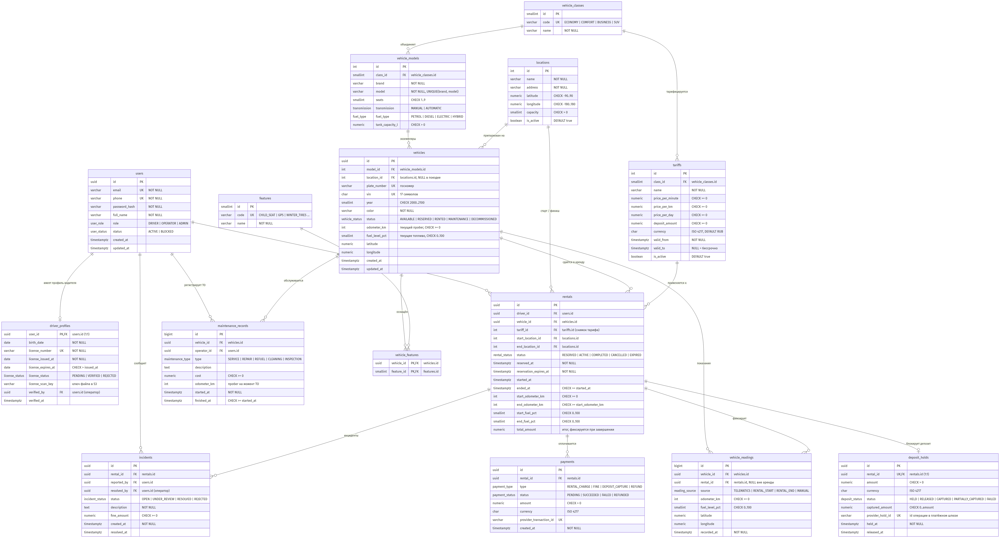

# Лабораторная работа № 5

**Интеграция серверного приложения с СУБД PostgreSQL, миграции схемы базы данных и оркестрация сервисов с помощью Docker Compose**

| | |
|---|---|
| Дисциплина | «Разработка серверных приложений» |
| Вариант | 5 — Сервис аренды автомобилей (Carsharing / Rental API) |
| Студент | ___________________ |
| Группа | ___________ |
| Репозиторий | https://github.com/Misterser1/carsharing-service |

## 1. Цель работы

Получить практические навыки подключения серверного приложения к реляционной СУБД PostgreSQL, описания структуры базы данных с помощью версионируемых SQL-миграций и организации совместного запуска приложения, СУБД и инструмента миграций средствами Docker Compose.

## 2. Что сделано

| Задача | Где в проекте |
|---|---|
| ERD из ЛР1 переведена в миграцию `000001_init_schema`: 15 таблиц в 3НФ, 13 ENUM-типов, PK, FK с явным правилом `ON DELETE`, `NOT NULL`, `UNIQUE`, `CHECK`, индексы на всех 22 столбцах внешних ключей | [migrations/](../migrations/) |
| Инфраструктура описана в `docker-compose.yml`: `db` (PostgreSQL 16, именованный том `pgdata`, `healthcheck`), `migrate` (golang-migrate v4.18.1), `app` (образ из ЛР4) | [docker-compose.yml](../docker-compose.yml) |
| Параметры подключения и пароль вынесены в `.env`; в репозитории только шаблон `.env.example`, `.env` — в `.gitignore` | [.env.example](../.env.example), [.gitignore](../.gitignore) |
| Модуль конфигурации читает `DB_HOST`, `DB_PORT`, `DB_USER`, `DB_PASSWORD`, `DB_NAME`, `DB_MAX_CONNS` и останавливает запуск с понятным сообщением, если обязательная переменная не задана | [app/core/config.py](../app/core/config.py) |
| Подключение через пул соединений psycopg 3 + psycopg_pool с ограниченным размером и повторными попытками при старте | [app/core/database.py](../app/core/database.py) |
| `GET /health` и `GET /api/v1/health` проверяют БД: `200` и `"db":"up"` или `503 Service Unavailable` и `"db":"down"` | [app/api/health.py](../app/api/health.py) |

Стек — Python, поэтому драйвер и пул взяты из таблицы 2 задания: psycopg 3 и psycopg_pool (параметр размера пула — `max_size`). Инструмент миграций — рекомендованный golang-migrate в отдельном контейнере: он не зависит от языка приложения, а имена файлов `000001_init_schema.up.sql` / `.down.sql` соответствуют его шаблону.

## 3. ERD-модель (из ЛР1)



Описание сущностей, связей и нормализации до 3НФ — в [ARCHITECTURE.md, раздел 6](../ARCHITECTURE.md#6-модель-данных-erd-3nf).

### Правила `ON DELETE`

| Правило | Где | Почему |
|---|---|---|
| `CASCADE` | `driver_profiles.user_id`, `vehicle_features.*`, `vehicle_readings.vehicle_id`, `maintenance_records.vehicle_id` | Дочерняя запись — часть родителя и без него не имеет смысла |
| `SET NULL` | `vehicles.location_id`, `vehicle_readings.rental_id` | Необязательная ссылка: автомобиль остаётся без парковки, показание — вне аренды |
| `RESTRICT` | все ссылки из `rentals`, `payments`, `deposit_holds`, `incidents`; справочники классов и моделей; `maintenance_records.operator_id`; `driver_profiles.verified_by` | История поездок и деньги не должны пропадать незаметно. Пользователей, автомобили и тарифы не удаляют, а выводят из оборота статусом |

`driver_profiles.verified_by` в схеме ЛР1 был `SET NULL`, но `CHECK` требует, чтобы у проверенного профиля это поле было заполнено, поэтому удаление оператора всё равно упало бы с ошибкой. В миграции правило исправлено на `RESTRICT`.

## 4. Листинг миграций

### `migrations/000001_init_schema.up.sql`

<details>
<summary>Полный листинг (342 строк)</summary>

```sql
-- =============================================================================
-- 000001_init_schema (up): схема БД сервиса аренды автомобилей по ERD из ЛР1, 3NF.
-- PostgreSQL 16. gen_random_uuid() встроена в PostgreSQL начиная с версии 13.
--
-- Правила ON DELETE:
--   CASCADE  — дочерняя запись не имеет смысла без родителя
--              (профиль водителя без пользователя, опции и журналы удалённого авто);
--   SET NULL — необязательная ссылка, запись остаётся
--              (авто без парковки, показание вне аренды);
--   RESTRICT — история и деньги: нельзя удалить пользователя, авто, тариф или парковку,
--              если на них ссылаются аренды, платежи, инциденты. Такие объекты
--              не удаляют, а выводят из оборота (users.status, vehicles.status, is_active).
-- PostgreSQL не создаёт индексы на столбцах внешних ключей сам — они созданы явно.
-- =============================================================================

-- -----------------------------------------------------------------------------
-- Перечисления (ENUM)
-- -----------------------------------------------------------------------------
CREATE TYPE user_role        AS ENUM ('DRIVER', 'OPERATOR', 'ADMIN');
CREATE TYPE user_status      AS ENUM ('ACTIVE', 'BLOCKED');
CREATE TYPE license_status   AS ENUM ('PENDING', 'VERIFIED', 'REJECTED');
CREATE TYPE transmission     AS ENUM ('MANUAL', 'AUTOMATIC');
CREATE TYPE fuel_type        AS ENUM ('PETROL', 'DIESEL', 'ELECTRIC', 'HYBRID');
CREATE TYPE vehicle_status   AS ENUM ('AVAILABLE', 'RESERVED', 'RENTED', 'MAINTENANCE', 'DECOMMISSIONED');
CREATE TYPE rental_status    AS ENUM ('RESERVED', 'ACTIVE', 'COMPLETED', 'CANCELLED', 'EXPIRED');
CREATE TYPE reading_source   AS ENUM ('TELEMATICS', 'RENTAL_START', 'RENTAL_END', 'MANUAL');
CREATE TYPE deposit_status   AS ENUM ('HELD', 'RELEASED', 'CAPTURED', 'PARTIALLY_CAPTURED', 'FAILED');
CREATE TYPE payment_type     AS ENUM ('RENTAL_CHARGE', 'FINE', 'DEPOSIT_CAPTURE', 'REFUND');
CREATE TYPE payment_status   AS ENUM ('PENDING', 'SUCCEEDED', 'FAILED', 'REFUNDED');
CREATE TYPE maintenance_type AS ENUM ('SERVICE', 'REPAIR', 'REFUEL', 'CLEANING', 'INSPECTION');
CREATE TYPE incident_status  AS ENUM ('OPEN', 'UNDER_REVIEW', 'RESOLVED', 'REJECTED');

-- -----------------------------------------------------------------------------
-- Пользователи
-- -----------------------------------------------------------------------------
CREATE TABLE users (
    id            UUID         PRIMARY KEY DEFAULT gen_random_uuid(),
    email         VARCHAR(255) NOT NULL,
    phone         VARCHAR(20)  NOT NULL,
    password_hash VARCHAR(255) NOT NULL,
    full_name     VARCHAR(150) NOT NULL,
    role          user_role    NOT NULL DEFAULT 'DRIVER',
    status        user_status  NOT NULL DEFAULT 'ACTIVE',
    created_at    TIMESTAMPTZ  NOT NULL DEFAULT now(),
    updated_at    TIMESTAMPTZ  NOT NULL DEFAULT now(),

    CONSTRAINT uq_users_email UNIQUE (email),
    CONSTRAINT uq_users_phone UNIQUE (phone),
    CONSTRAINT ck_users_email_lower CHECK (email = lower(email))
);
CREATE INDEX ix_users_role ON users (role);

CREATE TABLE driver_profiles (
    -- 1:1 с users: PK = FK; профиль без пользователя не нужен -> CASCADE
    user_id            UUID           PRIMARY KEY REFERENCES users (id) ON DELETE CASCADE,
    birth_date         DATE           NOT NULL,
    license_number     VARCHAR(20)    NOT NULL,
    license_issued_at  DATE           NOT NULL,
    license_expires_at DATE           NOT NULL,
    license_status     license_status NOT NULL DEFAULT 'PENDING',
    license_scan_key   VARCHAR(255),                 -- ключ файла скана в S3
    -- RESTRICT: у проверенного профиля verified_by обязателен (ck_driver_profiles_verified),
    -- SET NULL нарушил бы это правило
    verified_by        UUID           REFERENCES users (id) ON DELETE RESTRICT,
    verified_at        TIMESTAMPTZ,

    CONSTRAINT uq_driver_profiles_license UNIQUE (license_number),
    CONSTRAINT ck_driver_profiles_license_dates CHECK (license_expires_at > license_issued_at),
    CONSTRAINT ck_driver_profiles_age CHECK (birth_date <= CURRENT_DATE - INTERVAL '18 years'),
    CONSTRAINT ck_driver_profiles_verified CHECK (
        license_status <> 'VERIFIED' OR (verified_by IS NOT NULL AND verified_at IS NOT NULL)
    )
);
CREATE INDEX ix_driver_profiles_status      ON driver_profiles (license_status);
CREATE INDEX ix_driver_profiles_verified_by ON driver_profiles (verified_by);

-- -----------------------------------------------------------------------------
-- Автопарк
-- -----------------------------------------------------------------------------
CREATE TABLE vehicle_classes (
    id   SMALLSERIAL PRIMARY KEY,
    code VARCHAR(20) NOT NULL,
    name VARCHAR(50) NOT NULL,

    CONSTRAINT uq_vehicle_classes_code UNIQUE (code)
);

CREATE TABLE vehicle_models (
    id              SERIAL       PRIMARY KEY,
    class_id        SMALLINT     NOT NULL REFERENCES vehicle_classes (id) ON DELETE RESTRICT,
    brand           VARCHAR(50)  NOT NULL,
    model           VARCHAR(50)  NOT NULL,
    seats           SMALLINT     NOT NULL,
    transmission    transmission NOT NULL,
    fuel_type       fuel_type    NOT NULL,
    tank_capacity_l NUMERIC(5,1),

    CONSTRAINT uq_vehicle_models_brand_model UNIQUE (brand, model),
    CONSTRAINT ck_vehicle_models_seats CHECK (seats BETWEEN 1 AND 9),
    CONSTRAINT ck_vehicle_models_tank CHECK (tank_capacity_l IS NULL OR tank_capacity_l > 0)
);
CREATE INDEX ix_vehicle_models_class ON vehicle_models (class_id);

CREATE TABLE locations (
    id        SERIAL       PRIMARY KEY,
    name      VARCHAR(100) NOT NULL,
    address   VARCHAR(255) NOT NULL,
    latitude  NUMERIC(9,6) NOT NULL,
    longitude NUMERIC(9,6) NOT NULL,
    capacity  SMALLINT     NOT NULL,
    is_active BOOLEAN      NOT NULL DEFAULT TRUE,

    CONSTRAINT ck_locations_lat CHECK (latitude BETWEEN -90 AND 90),
    CONSTRAINT ck_locations_lng CHECK (longitude BETWEEN -180 AND 180),
    CONSTRAINT ck_locations_capacity CHECK (capacity > 0)
);

CREATE TABLE vehicles (
    id             UUID           PRIMARY KEY DEFAULT gen_random_uuid(),
    model_id       INTEGER        NOT NULL REFERENCES vehicle_models (id) ON DELETE RESTRICT,
    -- парковку можно удалить, авто остаётся (NULL — авто в поездке или вне парковки)
    location_id    INTEGER        REFERENCES locations (id) ON DELETE SET NULL,
    plate_number   VARCHAR(12)    NOT NULL,
    vin            CHAR(17)       NOT NULL,
    year           SMALLINT       NOT NULL,
    color          VARCHAR(30)    NOT NULL,
    status         vehicle_status NOT NULL DEFAULT 'AVAILABLE',
    odometer_km    INTEGER        NOT NULL DEFAULT 0,     -- текущий пробег
    fuel_level_pct SMALLINT       NOT NULL DEFAULT 100,   -- текущий уровень топлива / заряда, %
    latitude       NUMERIC(9,6),
    longitude      NUMERIC(9,6),
    created_at     TIMESTAMPTZ    NOT NULL DEFAULT now(),
    updated_at     TIMESTAMPTZ    NOT NULL DEFAULT now(),

    CONSTRAINT uq_vehicles_plate_number UNIQUE (plate_number),
    CONSTRAINT uq_vehicles_vin UNIQUE (vin),
    CONSTRAINT ck_vehicles_plate_upper CHECK (plate_number = upper(plate_number)),
    CONSTRAINT ck_vehicles_year CHECK (year BETWEEN 2000 AND 2100),
    CONSTRAINT ck_vehicles_odometer CHECK (odometer_km >= 0),
    CONSTRAINT ck_vehicles_fuel CHECK (fuel_level_pct BETWEEN 0 AND 100),
    CONSTRAINT ck_vehicles_lat CHECK (latitude IS NULL OR latitude BETWEEN -90 AND 90),
    CONSTRAINT ck_vehicles_lng CHECK (longitude IS NULL OR longitude BETWEEN -180 AND 180)
);
CREATE INDEX ix_vehicles_model           ON vehicles (model_id);
CREATE INDEX ix_vehicles_location        ON vehicles (location_id);
CREATE INDEX ix_vehicles_status          ON vehicles (status);
CREATE INDEX ix_vehicles_status_location ON vehicles (status, location_id);   -- свободные авто на парковке

CREATE TABLE features (
    id   SMALLSERIAL  PRIMARY KEY,
    code VARCHAR(30)  NOT NULL,
    name VARCHAR(100) NOT NULL,

    CONSTRAINT uq_features_code UNIQUE (code)
);

-- Связь N:M автомобиль <-> опция: строка связи не нужна без любой из сторон -> CASCADE
CREATE TABLE vehicle_features (
    vehicle_id UUID     NOT NULL REFERENCES vehicles (id) ON DELETE CASCADE,
    feature_id SMALLINT NOT NULL REFERENCES features (id) ON DELETE CASCADE,

    CONSTRAINT pk_vehicle_features PRIMARY KEY (vehicle_id, feature_id)
);
-- vehicle_id покрыт первым столбцом PK, для feature_id нужен отдельный индекс
CREATE INDEX ix_vehicle_features_feature ON vehicle_features (feature_id);

-- -----------------------------------------------------------------------------
-- Тарифы
-- -----------------------------------------------------------------------------
CREATE TABLE tariffs (
    id               SERIAL        PRIMARY KEY,
    class_id         SMALLINT      NOT NULL REFERENCES vehicle_classes (id) ON DELETE RESTRICT,
    name             VARCHAR(100)  NOT NULL,
    price_per_minute NUMERIC(10,2) NOT NULL,
    price_per_km     NUMERIC(10,2) NOT NULL,
    price_per_day    NUMERIC(10,2) NOT NULL,
    deposit_amount   NUMERIC(10,2) NOT NULL,    -- сумма блокировки депозита
    currency         CHAR(3)       NOT NULL DEFAULT 'RUB',
    valid_from       TIMESTAMPTZ   NOT NULL DEFAULT now(),
    valid_to         TIMESTAMPTZ,               -- NULL = бессрочно
    is_active        BOOLEAN       NOT NULL DEFAULT TRUE,

    CONSTRAINT ck_tariffs_prices CHECK (
        price_per_minute >= 0 AND price_per_km >= 0 AND price_per_day >= 0 AND deposit_amount >= 0
    ),
    CONSTRAINT ck_tariffs_period CHECK (valid_to IS NULL OR valid_to > valid_from)
);
CREATE INDEX ix_tariffs_class_active ON tariffs (class_id, is_active);

-- -----------------------------------------------------------------------------
-- Аренды: история поездок не теряется -> все ссылки RESTRICT
-- -----------------------------------------------------------------------------
CREATE TABLE rentals (
    id                     UUID          PRIMARY KEY DEFAULT gen_random_uuid(),
    driver_id              UUID          NOT NULL REFERENCES users (id) ON DELETE RESTRICT,
    vehicle_id             UUID          NOT NULL REFERENCES vehicles (id) ON DELETE RESTRICT,
    tariff_id              INTEGER       NOT NULL REFERENCES tariffs (id) ON DELETE RESTRICT,
    start_location_id      INTEGER       REFERENCES locations (id) ON DELETE RESTRICT,
    end_location_id        INTEGER       REFERENCES locations (id) ON DELETE RESTRICT,
    status                 rental_status NOT NULL DEFAULT 'RESERVED',
    reserved_at            TIMESTAMPTZ   NOT NULL DEFAULT now(),
    reservation_expires_at TIMESTAMPTZ   NOT NULL,
    started_at             TIMESTAMPTZ,
    ended_at               TIMESTAMPTZ,
    start_odometer_km      INTEGER,
    end_odometer_km        INTEGER,
    start_fuel_pct         SMALLINT,
    end_fuel_pct           SMALLINT,
    total_amount           NUMERIC(10,2),     -- итоговая сумма, фиксируется при завершении

    CONSTRAINT ck_rentals_reservation CHECK (reservation_expires_at > reserved_at),
    CONSTRAINT ck_rentals_times CHECK (
        (started_at IS NULL OR started_at >= reserved_at)
        AND (ended_at IS NULL OR (started_at IS NOT NULL AND ended_at >= started_at))
    ),
    CONSTRAINT ck_rentals_odometer CHECK (
        (start_odometer_km IS NULL OR start_odometer_km >= 0)
        AND (end_odometer_km IS NULL OR end_odometer_km >= start_odometer_km)
    ),
    CONSTRAINT ck_rentals_fuel CHECK (
        (start_fuel_pct IS NULL OR start_fuel_pct BETWEEN 0 AND 100)
        AND (end_fuel_pct IS NULL OR end_fuel_pct BETWEEN 0 AND 100)
    ),
    CONSTRAINT ck_rentals_total CHECK (total_amount IS NULL OR total_amount >= 0),
    -- завершённая аренда обязана иметь показания старта и финиша и итоговую сумму
    CONSTRAINT ck_rentals_completed CHECK (
        status <> 'COMPLETED'
        OR (started_at IS NOT NULL AND ended_at IS NOT NULL
            AND start_odometer_km IS NOT NULL AND end_odometer_km IS NOT NULL
            AND start_fuel_pct IS NOT NULL AND end_fuel_pct IS NOT NULL
            AND total_amount IS NOT NULL)
    )
);
CREATE INDEX ix_rentals_driver          ON rentals (driver_id);
CREATE INDEX ix_rentals_vehicle         ON rentals (vehicle_id);
CREATE INDEX ix_rentals_tariff          ON rentals (tariff_id);
CREATE INDEX ix_rentals_start_location  ON rentals (start_location_id);
CREATE INDEX ix_rentals_end_location    ON rentals (end_location_id);
CREATE INDEX ix_rentals_status_expires  ON rentals (status, reservation_expires_at);   -- истёкшие резервы
CREATE INDEX ix_rentals_driver_reserved ON rentals (driver_id, reserved_at DESC);      -- история поездок

-- Не более одной незавершённой аренды на автомобиль и на водителя (защита от двойной брони)
CREATE UNIQUE INDEX ux_rentals_vehicle_open ON rentals (vehicle_id) WHERE status IN ('RESERVED', 'ACTIVE');
CREATE UNIQUE INDEX ux_rentals_driver_open  ON rentals (driver_id)  WHERE status IN ('RESERVED', 'ACTIVE');

CREATE TABLE vehicle_readings (
    id             BIGSERIAL      PRIMARY KEY,
    vehicle_id     UUID           NOT NULL REFERENCES vehicles (id) ON DELETE CASCADE,
    rental_id      UUID           REFERENCES rentals (id) ON DELETE SET NULL,   -- NULL вне аренды
    source         reading_source NOT NULL,
    odometer_km    INTEGER        NOT NULL,
    fuel_level_pct SMALLINT       NOT NULL,
    latitude       NUMERIC(9,6),
    longitude      NUMERIC(9,6),
    recorded_at    TIMESTAMPTZ    NOT NULL DEFAULT now(),

    CONSTRAINT ck_vehicle_readings_odometer CHECK (odometer_km >= 0),
    CONSTRAINT ck_vehicle_readings_fuel CHECK (fuel_level_pct BETWEEN 0 AND 100)
);
CREATE INDEX ix_vehicle_readings_vehicle_time ON vehicle_readings (vehicle_id, recorded_at DESC);
CREATE INDEX ix_vehicle_readings_rental       ON vehicle_readings (rental_id);

-- -----------------------------------------------------------------------------
-- Деньги: финансовые записи не удаляются вместе с арендой -> RESTRICT
-- -----------------------------------------------------------------------------
CREATE TABLE deposit_holds (
    id               UUID           PRIMARY KEY DEFAULT gen_random_uuid(),
    rental_id        UUID           NOT NULL REFERENCES rentals (id) ON DELETE RESTRICT,
    amount           NUMERIC(10,2)  NOT NULL,
    currency         CHAR(3)        NOT NULL,
    status           deposit_status NOT NULL DEFAULT 'HELD',
    captured_amount  NUMERIC(10,2)  NOT NULL DEFAULT 0,
    provider_hold_id VARCHAR(100)   NOT NULL,    -- id операции hold в платёжном шлюзе
    held_at          TIMESTAMPTZ    NOT NULL DEFAULT now(),
    released_at      TIMESTAMPTZ,

    CONSTRAINT uq_deposit_holds_rental UNIQUE (rental_id),          -- 1:1 с арендой, он же индекс FK
    CONSTRAINT uq_deposit_holds_provider UNIQUE (provider_hold_id),
    CONSTRAINT ck_deposit_holds_amount CHECK (amount > 0),
    CONSTRAINT ck_deposit_holds_captured CHECK (captured_amount >= 0 AND captured_amount <= amount),
    CONSTRAINT ck_deposit_holds_released CHECK (released_at IS NULL OR released_at >= held_at)
);
CREATE INDEX ix_deposit_holds_status ON deposit_holds (status);

CREATE TABLE payments (
    id                      UUID           PRIMARY KEY DEFAULT gen_random_uuid(),
    rental_id               UUID           NOT NULL REFERENCES rentals (id) ON DELETE RESTRICT,
    type                    payment_type   NOT NULL,
    status                  payment_status NOT NULL DEFAULT 'PENDING',
    amount                  NUMERIC(10,2)  NOT NULL,
    currency                CHAR(3)        NOT NULL,
    provider_transaction_id VARCHAR(100),
    created_at              TIMESTAMPTZ    NOT NULL DEFAULT now(),

    CONSTRAINT uq_payments_provider_tx UNIQUE (provider_transaction_id),
    CONSTRAINT ck_payments_amount CHECK (amount > 0)
);
CREATE INDEX ix_payments_rental         ON payments (rental_id);
CREATE INDEX ix_payments_status_created ON payments (status, created_at);

-- -----------------------------------------------------------------------------
-- Эксплуатация
-- -----------------------------------------------------------------------------
CREATE TABLE maintenance_records (
    id          BIGSERIAL        PRIMARY KEY,
    vehicle_id  UUID             NOT NULL REFERENCES vehicles (id) ON DELETE CASCADE,
    operator_id UUID             NOT NULL REFERENCES users (id) ON DELETE RESTRICT,
    type        maintenance_type NOT NULL,
    description TEXT,
    cost        NUMERIC(10,2),
    odometer_km INTEGER          NOT NULL,     -- пробег на момент работ
    started_at  TIMESTAMPTZ      NOT NULL DEFAULT now(),
    finished_at TIMESTAMPTZ,

    CONSTRAINT ck_maintenance_cost CHECK (cost IS NULL OR cost >= 0),
    CONSTRAINT ck_maintenance_odometer CHECK (odometer_km >= 0),
    CONSTRAINT ck_maintenance_times CHECK (finished_at IS NULL OR finished_at >= started_at)
);
CREATE INDEX ix_maintenance_vehicle_time ON maintenance_records (vehicle_id, started_at DESC);
CREATE INDEX ix_maintenance_operator     ON maintenance_records (operator_id);

CREATE TABLE incidents (
    id          UUID            PRIMARY KEY DEFAULT gen_random_uuid(),
    rental_id   UUID            NOT NULL REFERENCES rentals (id) ON DELETE RESTRICT,
    reported_by UUID            NOT NULL REFERENCES users (id) ON DELETE RESTRICT,
    resolved_by UUID            REFERENCES users (id) ON DELETE RESTRICT,
    status      incident_status NOT NULL DEFAULT 'OPEN',
    description TEXT            NOT NULL,
    fine_amount NUMERIC(10,2),     -- сумма к удержанию из депозита
    created_at  TIMESTAMPTZ     NOT NULL DEFAULT now(),
    resolved_at TIMESTAMPTZ,

    CONSTRAINT ck_incidents_fine CHECK (fine_amount IS NULL OR fine_amount >= 0),
    CONSTRAINT ck_incidents_resolved CHECK (
        status IN ('OPEN', 'UNDER_REVIEW')
        OR (resolved_by IS NOT NULL AND resolved_at IS NOT NULL)
    )
);
CREATE INDEX ix_incidents_rental         ON incidents (rental_id);
CREATE INDEX ix_incidents_reported_by    ON incidents (reported_by);
CREATE INDEX ix_incidents_resolved_by    ON incidents (resolved_by);
CREATE INDEX ix_incidents_status_created ON incidents (status, created_at);
```

</details>

### `migrations/000001_init_schema.down.sql`

```sql
-- =============================================================================
-- 000001_init_schema (down): откат схемы.
-- Порядок обратный созданию: сначала таблицы, которые ссылаются на другие,
-- затем таблицы, на которые ссылаются; в конце ENUM-типы. Индексы удаляются вместе с таблицами.
-- ВНИМАНИЕ: откат удаляет все данные этих таблиц.
-- =============================================================================

DROP TABLE IF EXISTS incidents;
DROP TABLE IF EXISTS maintenance_records;
DROP TABLE IF EXISTS payments;
DROP TABLE IF EXISTS deposit_holds;
DROP TABLE IF EXISTS vehicle_readings;
DROP TABLE IF EXISTS rentals;
DROP TABLE IF EXISTS tariffs;
DROP TABLE IF EXISTS vehicle_features;
DROP TABLE IF EXISTS features;
DROP TABLE IF EXISTS vehicles;
DROP TABLE IF EXISTS locations;
DROP TABLE IF EXISTS vehicle_models;
DROP TABLE IF EXISTS vehicle_classes;
DROP TABLE IF EXISTS driver_profiles;
DROP TABLE IF EXISTS users;

DROP TYPE IF EXISTS incident_status;
DROP TYPE IF EXISTS maintenance_type;
DROP TYPE IF EXISTS payment_status;
DROP TYPE IF EXISTS payment_type;
DROP TYPE IF EXISTS deposit_status;
DROP TYPE IF EXISTS reading_source;
DROP TYPE IF EXISTS rental_status;
DROP TYPE IF EXISTS vehicle_status;
DROP TYPE IF EXISTS fuel_type;
DROP TYPE IF EXISTS transmission;
DROP TYPE IF EXISTS license_status;
DROP TYPE IF EXISTS user_status;
DROP TYPE IF EXISTS user_role;
```

## 5. Листинг `docker-compose.yml`

```yaml
# Инфраструктура проекта: PostgreSQL, миграции (golang-migrate) и приложение.
# Значения ${...} Compose берёт из файла .env (шаблон — .env.example); паролей здесь нет.
#
#   docker compose up --build -d          # запуск всего окружения
#   docker compose run --rm migrate down 1   # откат последней миграции
#   docker compose run --rm migrate up       # повторное применение

name: carsharing

services:
  db:
    image: postgres:16-alpine
    restart: unless-stopped
    environment:
      # :? — Compose остановится с понятной ошибкой, если переменной нет в .env
      POSTGRES_USER: ${DB_USER:?DB_USER is not set in .env}
      POSTGRES_PASSWORD: ${DB_PASSWORD:?DB_PASSWORD is not set in .env}
      POSTGRES_DB: ${DB_NAME:?DB_NAME is not set in .env}
    ports:
      # только на localhost хост-машины: БД не должна быть доступна из сети
      - "127.0.0.1:${DB_HOST_PORT:-5432}:5432"
    volumes:
      - pgdata:/var/lib/postgresql/data
    healthcheck:
      # $$ — переменная раскрывается внутри контейнера; -h 127.0.0.1 — проверяем TCP:
      # во время первой инициализации временный сервер слушает только unix-сокет
      test: ["CMD-SHELL", "pg_isready -h 127.0.0.1 -U $${POSTGRES_USER} -d $${POSTGRES_DB}"]
      interval: 5s
      timeout: 5s
      retries: 10
      start_period: 10s

  migrate:
    image: migrate/migrate:v4.18.1
    volumes:
      - ./migrations:/migrations:ro
    # Путь и строка подключения — в entrypoint, действие — в command.
    # `docker compose run migrate down 1` заменяет только command, строку подключения
    # повторять не нужно.
    entrypoint:
      - migrate
      - -path=/migrations
      - -database=postgres://${DB_USER}:${DB_PASSWORD}@db:5432/${DB_NAME}?sslmode=disable
    command: ["up"]
    depends_on:
      db:
        condition: service_healthy
    restart: "no"

  app:
    build:
      context: .
      dockerfile: Dockerfile
    restart: unless-stopped
    ports:
      - "${HTTP_PORT:-8080}:8080"
    environment:
      APP_NAME: ${APP_NAME:-Carsharing Rental API}
      APP_ENV: ${APP_ENV:-production}
      LOG_LEVEL: ${LOG_LEVEL:-INFO}
      HTTP_PORT: 8080
      # db — имя сервиса: внутри сети Compose его разрешает встроенный DNS Docker
      DB_HOST: db
      DB_PORT: 5432
      DB_USER: ${DB_USER}
      DB_PASSWORD: ${DB_PASSWORD}
      DB_NAME: ${DB_NAME}
      DB_MAX_CONNS: ${DB_MAX_CONNS:-10}
    depends_on:
      db:
        condition: service_healthy
      migrate:
        condition: service_completed_successfully

volumes:
  pgdata:
```

Отличие от примера в задании: путь к миграциям и строка подключения вынесены в `entrypoint` сервиса `migrate`, а в `command` осталось только действие. `docker compose run` заменяет `command`, но не `entrypoint`, поэтому для отката достаточно `docker compose run --rm migrate down 1` — пароль не приходится повторять в командной строке.

## 6. Результаты проверки

Проверка выполнена в Docker Engine 29.1.3 и Docker Compose 2.40.3. Значения из `.env`: пользователь `app_user`, база `carsharing`; пароль задан свой и в отчёт не попадает.

### 6.1 Запуск окружения

```
$ docker compose up --build -d
...
 Container carsharing-migrate-1  Starting
 Container carsharing-migrate-1  Started
 Container carsharing-migrate-1  Waiting
 Container carsharing-db-1  Waiting
 Container carsharing-db-1  Healthy
 Container carsharing-migrate-1  Exited
 Container carsharing-app-1  Starting
 Container carsharing-app-1  Started

$ docker compose ps -a
NAME                   IMAGE                     COMMAND                  SERVICE   CREATED          STATUS                            PORTS
carsharing-app-1       carsharing-app            "python -m app"          app       11 seconds ago   Up 2 seconds (health: starting)   0.0.0.0:8080->8080/tcp, [::]:8080->8080/tcp
carsharing-db-1        postgres:16-alpine        "docker-entrypoint.s…"   db        17 seconds ago   Up 10 seconds (healthy)           127.0.0.1:5432->5432/tcp
carsharing-migrate-1   migrate/migrate:v4.18.1   "migrate -path=/migr…"   migrate   12 seconds ago   Exited (0) 4 seconds ago          
```

`db` — `healthy`, `migrate` применил миграцию и завершился с кодом 0, `app` запущен после него.

### 6.2 Журналы сервисов

```
$ docker compose logs migrate
migrate-1  | 1/u init_schema (330.607976ms)

$ docker compose logs app
app-1  | 2026-11-19 09:50:10,869 INFO app.main: [CONFIG] Environment variables loaded successfully
app-1  | INFO:     Started server process [1]
app-1  | INFO:     Waiting for application startup.
app-1  | 2026-11-19 09:50:10,989 INFO app.core.database: [DATABASE] Successfully connected to PostgreSQL at db:5432 (pool max 10)
app-1  | 2026-11-19 09:50:10,989 INFO app.main: [HTTP] Server starting on port 8080
app-1  | INFO:     Application startup complete.
app-1  | INFO:     Uvicorn running on http://0.0.0.0:8080 (Press CTRL+C to quit)
app-1  | INFO:     172.18.0.1:33978 - "GET /api/v1/health HTTP/1.1" 200 OK
app-1  | INFO:     127.0.0.1:41620 - "GET /api/v1/health HTTP/1.1" 200 OK
```

Миграция применена (`1/u init_schema`), приложение прочитало конфигурацию и подключилось к PostgreSQL по имени сервиса `db`.

### 6.3 Схема и версия миграций

```
$ docker compose exec db psql -U app_user -d carsharing -c "\dt"
                List of relations
 Schema |        Name         | Type  |  Owner   
--------+---------------------+-------+----------
 public | deposit_holds       | table | app_user
 public | driver_profiles     | table | app_user
 public | features            | table | app_user
 public | incidents           | table | app_user
 public | locations           | table | app_user
 public | maintenance_records | table | app_user
 public | payments            | table | app_user
 public | rentals             | table | app_user
 public | schema_migrations   | table | app_user
 public | tariffs             | table | app_user
 public | users               | table | app_user
 public | vehicle_classes     | table | app_user
 public | vehicle_features    | table | app_user
 public | vehicle_models      | table | app_user
 public | vehicle_readings    | table | app_user
 public | vehicles            | table | app_user
(16 rows)

$ docker compose exec db psql -U app_user -d carsharing -c "SELECT version, dirty FROM schema_migrations;"
 version | dirty 
---------+-------
       1 | f
(1 row)
```

15 таблиц системы и служебная `schema_migrations` с `version = 1`, `dirty = f`.

### 6.4 Эндпоинт состояния: 200 и 503

```
$ curl -i http://localhost:8080/health
HTTP/1.1 200 OK
date: Thu, 19 Nov 2026 09:50:26 GMT
server: uvicorn
content-length: 128
content-type: application/json
x-request-id: 1068e453-a392-413d-8886-94ebfda5c3b2

{"status":"pass","app_name":"Carsharing Rental API","version":"1.0.0","environment":"development","uptime_seconds":16,"db":"up"}

$ docker compose stop db
 Container carsharing-db-1  Stopping
 Container carsharing-db-1  Stopped

$ curl -i http://localhost:8080/health
HTTP/1.1 503 Service Unavailable
date: Thu, 19 Nov 2026 09:50:29 GMT
server: uvicorn
content-length: 130
content-type: application/json
x-request-id: 36ff410b-15e3-45ef-8cf6-b26c62395164

{"status":"fail","app_name":"Carsharing Rental API","version":"1.0.0","environment":"development","uptime_seconds":20,"db":"down"}

$ docker compose start db
 Container carsharing-db-1  Starting
 Container carsharing-db-1  Started

$ curl -i http://localhost:8080/health
HTTP/1.1 200 OK
date: Thu, 19 Nov 2026 09:50:36 GMT
server: uvicorn
content-length: 128
content-type: application/json
x-request-id: c749b0be-b429-4887-977d-bb3545a8e5e0

{"status":"pass","app_name":"Carsharing Rental API","version":"1.0.0","environment":"development","uptime_seconds":26,"db":"up"}
```

При остановленной БД `/health` отвечает `503 Service Unavailable` с `"db":"down"`. После запуска БД пул сам заменяет оборванные соединения, и сервис снова отвечает `200` без перезапуска приложения.

### 6.5 Ограничения целостности

```
$ docker compose exec db psql -U app_user -d carsharing -c "INSERT INTO locations (name, address, latitude, longitude, capacity) VALUES ('Парковка Тверская', 'ул. Тверская, 1', 55.7576, 37.6131, 20);"
INSERT 0 1
$ docker compose exec db psql -U app_user -d carsharing -c "INSERT INTO locations (name, address, latitude, longitude, capacity) VALUES ('Парковка B', 'ул. Ленина, 5', 55.75, 37.61, -5);"
ERROR:  new row for relation "locations" violates check constraint "ck_locations_capacity"
DETAIL:  Failing row contains (2, Парковка B, ул. Ленина, 5, 55.750000, 37.610000, -5, t).
```

Первая вставка выполнена, вторая отклонена ограничением `ck_locations_capacity` (вместимость парковки должна быть больше нуля).

### 6.6 Сохранность данных

```
$ docker compose down
 Container carsharing-app-1  Stopping
 Container carsharing-app-1  Stopped
 Container carsharing-app-1  Removing
 Container carsharing-app-1  Removed
 Container carsharing-migrate-1  Stopping
 Container carsharing-migrate-1  Stopped
 Container carsharing-migrate-1  Removing
 Container carsharing-migrate-1  Removed
 Container carsharing-db-1  Stopping
 Container carsharing-db-1  Stopped
 Container carsharing-db-1  Removing
 Container carsharing-db-1  Removed
 Network carsharing_default  Removing
 Network carsharing_default  Removed

$ docker volume ls
DRIVER    VOLUME NAME
local     carsharing_pgdata

$ docker compose up -d
 Network carsharing_default  Creating
 Network carsharing_default  Created
 Container carsharing-db-1  Creating
 Container carsharing-db-1  Created
 Container carsharing-migrate-1  Creating
 Container carsharing-migrate-1  Created
 Container carsharing-app-1  Creating
 Container carsharing-app-1  Created
 Container carsharing-db-1  Starting
 Container carsharing-db-1  Started
 Container carsharing-db-1  Waiting
 Container carsharing-db-1  Healthy
 Container carsharing-migrate-1  Starting
 Container carsharing-migrate-1  Started
 Container carsharing-migrate-1  Waiting
 Container carsharing-db-1  Waiting
 Container carsharing-db-1  Healthy
 Container carsharing-migrate-1  Exited
 Container carsharing-app-1  Starting
 Container carsharing-app-1  Started

$ docker compose logs migrate
migrate-1  | no change

$ docker compose exec db psql -U app_user -d carsharing -c "SELECT name FROM locations;"
       name        
-------------------
 Парковка Тверская
(1 row)
```

`docker compose down` удалил контейнеры и сеть, но не том `carsharing_pgdata`, поэтому после `up` запись «Парковка Тверская» на месте. Миграция при повторном запуске не выполняется повторно (`no change`).

### 6.7 Откат и повторное применение миграции

Служебные строки Compose о проверке зависимостей (`Container carsharing-db-1 Running`) опущены.

```
$ docker compose run --rm migrate down 1
1/d init_schema (172.783894ms)

$ docker compose exec db psql -U app_user -d carsharing -c "\dt"
               List of relations
 Schema |       Name        | Type  |  Owner   
--------+-------------------+-------+----------
 public | schema_migrations | table | app_user
(1 row)

$ docker compose run --rm migrate up
1/u init_schema (306.036685ms)

$ docker compose exec db psql -U app_user -d carsharing -c "\dt"
                List of relations
 Schema |        Name         | Type  |  Owner   
--------+---------------------+-------+----------
 public | deposit_holds       | table | app_user
 public | driver_profiles     | table | app_user
 public | features            | table | app_user
 public | incidents           | table | app_user
 public | locations           | table | app_user
 public | maintenance_records | table | app_user
 public | payments            | table | app_user
 public | rentals             | table | app_user
 public | schema_migrations   | table | app_user
 public | tariffs             | table | app_user
 public | users               | table | app_user
 public | vehicle_classes     | table | app_user
 public | vehicle_features    | table | app_user
 public | vehicle_models      | table | app_user
 public | vehicle_readings    | table | app_user
 public | vehicles            | table | app_user
(16 rows)

$ docker compose exec db psql -U app_user -d carsharing -c "SELECT version, dirty FROM schema_migrations;"
 version | dirty 
---------+-------
       1 | f
(1 row)
```

После отката остаётся только `schema_migrations`, после повторного применения таблицы появляются снова, версия — снова 1. Откат удалил и данные: таблицы созданы заново пустыми.

## 7. Ответы на контрольные вопросы

### 7.1 Зачем нужны down-миграции? Почему откат миграции, удаляющей столбец или таблицу, не всегда безопасен?

Down-миграция возвращает схему к предыдущей версии. Она нужна, чтобы откатить неудачный релиз, проверить обратимость миграции при разработке (`up → down → up`) и переключаться между ветками с разной схемой.

Откат небезопасен, потому что удаление необратимо уничтожает данные:

- down-миграция, удаляющая таблицу или столбец, стирает всё, что туда успели записать. Например, `000001_init_schema.down.sql` удаляет все 15 таблиц вместе с арендами и платежами;
- если же столбец удалила up-миграция, down может вернуть только структуру — пустой столбец, а не данные;
- после отката схемы уже запущенная новая версия приложения может обращаться к удалённым объектам и падать.

Поэтому в промышленной эксплуатации ошибку чаще исправляют новой up-миграцией, а перед опасными изменениями делают резервную копию.

### 7.2 Почему нельзя изменять уже применённый файл миграции? Как инструмент миграций определяет, какие миграции уже применены?

golang-migrate хранит в самой БД служебную таблицу `schema_migrations` с номером последней применённой версии (`version`) и флагом `dirty`. Команда `up` применяет только файлы с номером больше записанного. Перед выполнением миграции флаг `dirty` ставится в `true`, после успеха — снимается; если миграция упала посередине, инструмент откажется работать, пока ошибку не исправят вручную.

Если изменить уже применённый файл, на тех базах, где он выполнен, ничего не произойдёт: номер уже записан, и файл повторно не запускается. Свежая база получит новую версию файла, а рабочая останется со старой, и схемы на разных серверах незаметно разойдутся. Любое изменение оформляется новой миграцией со следующим номером.

### 7.3 Почему в `docker-compose.yml` недостаточно указать `depends_on: [db]` и требуется `healthcheck`? Почему приложение всё равно должно уметь повторно подключаться к БД?

`depends_on` в короткой форме гарантирует только, что контейнер `db` **запущен**, а не что PostgreSQL **готова принимать соединения**. При первом старте контейнер несколько секунд выполняет `initdb`, создаёт базу и перезапускает сервер. Если в этот момент стартуют `migrate` или `app`, они получат `connection refused`. Проверка `pg_isready` в `healthcheck` и условие `condition: service_healthy` заставляют `migrate` ждать готовности БД, а `condition: service_completed_successfully` запускает `app` только после успешного применения миграций.

Повторные подключения всё равно нужны, потому что `depends_on` работает только при запуске через Compose:

- БД может перезапуститься, пока приложение работает (сбой, обновление, `restart: unless-stopped`);
- приложение могут запустить вне Compose (с хоста, в Kubernetes, где `depends_on` нет);
- возможны кратковременные сетевые сбои.

В проекте приложение делает до 10 попыток подключения с растущей паузой, а пул сам заменяет оборванные соединения: после перезапуска БД `/health` снова отвечает `200` без перезапуска приложения.

### 7.4 Какую роль играет именованный том `pgdata:/var/lib/postgresql/data`? Что произойдёт с данными после `docker compose down` и после `docker compose down -v`?

Файловая система контейнера временная: при удалении контейнера всё, что он записал внутри себя, пропадает. Именованный том `pgdata` — каталог, которым управляет Docker отдельно от жизненного цикла контейнера. Он монтируется в `/var/lib/postgresql/data`, где PostgreSQL хранит файлы базы, и новый контейнер `db` подключает тот же том с теми же данными.

- `docker compose down` останавливает и удаляет контейнеры и сеть, том остаётся. После `docker compose up` все данные на месте.
- `docker compose down -v` удаляет ещё и тома. Данные уничтожаются, при следующем запуске PostgreSQL заново выполнит `initdb`.

Следствие: переменные `POSTGRES_*` применяются только при инициализации пустого тома. Если поменять пароль в `.env`, существующая база его не узнает (ошибка `password authentication failed`), и для учебной БД помогает только `docker compose down -v`.

### 7.5 В чём разница между `DB_HOST=localhost` и `DB_HOST=db` для приложения внутри Docker Compose? Какое значение нужно при запуске приложения с хост-машины?

У каждого контейнера своё сетевое пространство. Внутри контейнера `app` адрес `localhost` указывает на сам контейнер `app`, где PostgreSQL нет, поэтому соединение будет отклонено. `db` — имя сервиса: встроенный DNS Docker в сети Compose разрешает его в IP-адрес контейнера `db`. Порт при этом внутренний, `5432`.

При запуске приложения с хост-машины (`python -m app`) имя `db` не разрешается. Нужен `DB_HOST=localhost` и порт, опубликованный на хост: `DB_PORT` = `DB_HOST_PORT`, по умолчанию `5432`. Compose публикует его только на `127.0.0.1`, чтобы БД не была доступна из сети. Поэтому в `.env` для локального запуска указан `localhost`, а в `docker-compose.yml` приложению явно передаются `DB_HOST: db` и `DB_PORT: 5432`.

### 7.6 Что такое пул соединений с базой данных? Почему его размер необходимо ограничивать и как он связан с параметром `max_connections` PostgreSQL?

Установка соединения с PostgreSQL дорогая: TCP-подключение, аутентификация, на сервере запускается отдельный процесс. Пул заранее открывает несколько соединений и переиспользует их: обработчик берёт соединение, выполняет запрос и возвращает его в пул.

Размер ограничивают, потому что каждое соединение — это процесс PostgreSQL со своей памятью. Сервер принимает не больше `max_connections` соединений (по умолчанию 100), остальные получают ошибку `too many clients`. Кроме того, соединений больше, чем ядер процессора, не ускоряют работу, а только добавляют конкуренцию за ресурсы. При ограниченном пуле лишние запросы ждут свободное соединение внутри приложения, а не перегружают СУБД.

Правило: (число экземпляров приложения) × (максимальный размер пула) < `max_connections` с запасом для администрирования и миграций. В проекте `DB_MAX_CONNS=10`: даже 8 экземпляров займут 80 соединений из 100.

### 7.7 Почему пароли нельзя хранить в коде и в `docker-compose.yml`? Как используются файлы `.env` и `.env.example`?

Код и `docker-compose.yml` лежат в Git:

- пароль видят все, у кого есть доступ к репозиторию, а при публичном репозитории — весь интернет;
- пароль остаётся в истории коммитов, даже если его потом удалить;
- на всех окружениях оказывается один и тот же пароль;
- чтобы сменить пароль, приходится менять код.

В проекте `docker-compose.yml` содержит только подстановки `${DB_PASSWORD}`. Compose автоматически читает файл `.env` из каталога проекта и подставляет значения. `.env` с настоящими значениями есть только на конкретной машине и указан в `.gitignore`. В репозитории лежит `.env.example`: список всех переменных с комментариями и безопасными значениями-заглушками (`change_me`). Новый разработчик выполняет `cp .env.example .env` и задаёт свой пароль. Если обязательной переменной нет, Compose (`${DB_PASSWORD:?...}`) и приложение останавливаются с понятным сообщением.

### 7.8 Почему для столбцов внешних ключей рекомендуется создавать индексы вручную? Как выбрать правило `ON DELETE` (`CASCADE`, `RESTRICT`, `SET NULL`)?

PostgreSQL автоматически создаёт индексы только для `PRIMARY KEY` и `UNIQUE`, но не для столбцов, которые ссылаются на другую таблицу. Без индекса:

- запросы по внешнему ключу (история аренд водителя `WHERE driver_id = ...`, `JOIN` аренд с автомобилями) читают всю таблицу;
- при удалении или изменении родительской строки PostgreSQL проверяет дочерние таблицы (есть ли аренды у удаляемого пользователя, какие строки удалить каскадом), и каждая такая проверка — полный просмотр.

Отдельный индекс не нужен, если столбец уже первый в первичном ключе или `UNIQUE` (`vehicle_features.vehicle_id`, `deposit_holds.rental_id`). В миграции проекта индексы есть на всех 22 внешних ключах; это проверено запросом к `pg_constraint` и `pg_index`.

Правило выбирают по смыслу связи:

- **`CASCADE`** — дочерняя запись является частью родителя (профиль водителя у пользователя, опции и журнал показаний автомобиля);
- **`RESTRICT`** — дочерние записи ценны сами по себе: история, деньги (аренды, платежи, депозиты, инциденты). Удаление родителя запрещено, вместо него используют статус («заблокирован», «списан»);
- **`SET NULL`** — ссылка необязательна, и запись имеет смысл без родителя (автомобиль без парковки). Столбец должен допускать `NULL` и не противоречить `CHECK`.

## 8. Выводы

- Схема БД из ЛР1 оформлена версионируемой миграцией: одна и та же команда `migrate up` безопасно приводит к актуальной схеме любую базу — пустую или уже обновлённую, а `schema_migrations` показывает, какая версия применена.
- Ограничения `NOT NULL`, `UNIQUE`, `CHECK` и внешние ключи переносят часть бизнес-правил в СУБД: даже при ошибке в коде в таблицы не попадут отрицательная вместимость парковки, уровень топлива больше 100 % или удаление пользователя с историей аренд.
- Docker Compose поднимает всё окружение одной командой в правильном порядке: БД → миграции → приложение. `healthcheck` и условия `depends_on` убирают гонку при старте, а именованный том сохраняет данные между пересозданиями контейнеров.
- Приложение не хранит секретов: конфигурация приходит из переменных окружения, пропущенная переменная останавливает запуск с понятным сообщением, а пароль не попадает ни в Git, ни в логи.
- Пул соединений ограниченного размера и повторные попытки подключения делают приложение устойчивым к недоступности БД: `/health` честно сообщает `503`, а после восстановления БД сервис продолжает работу без перезапуска.
